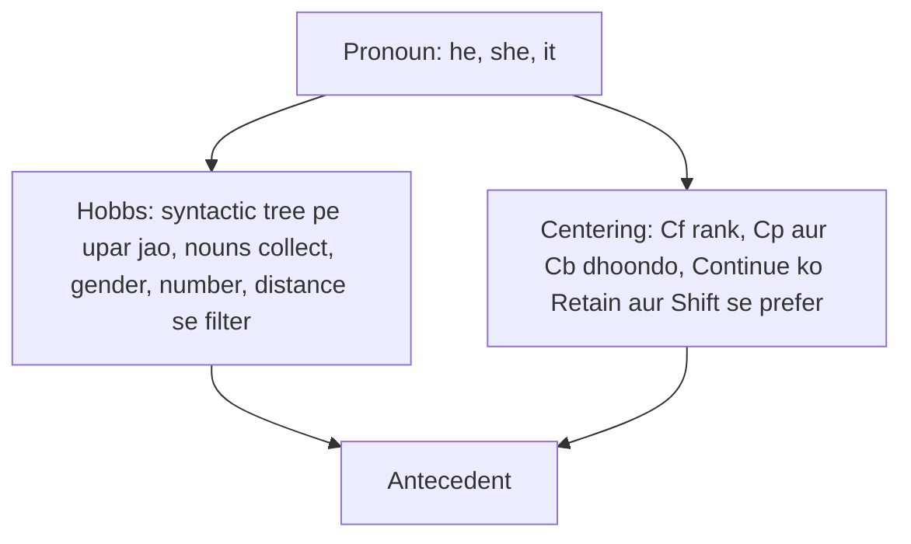

**In simple words:** anaphora resolution pronoun ko us pehle wale noun se jodta hai jiske liye wo aaya hai. Hobbs algorithm ye **syntactic tree mein search** karke karta hai; Centering algorithm **discourse ka focus follow** karke. (Paper mein "Cantering" likha hai, matlab Centering.) <Cite id="class-nlp-asol" loc="p. 1" />

**1. Hobbs algorithm** pronoun resolution ka heuristic method hai, Jerry Hobbs ne 1976 mein banaya. Ye syntactic tree use karta hai. *Steps:* pronoun se start karke upar jao, same level aur uske upar wale level mein nouns dekho; mile hue har noun ko consider karo; constraints lagao (gender, number agreement, distance); suitable antecedent na mile to repeat. *Example:* "John saw Mary, he greeted her." Nouns Mary aur John mile; *he* male hai, isliye he = John. <Cite id="class-nlp-asol" loc="p. 3" /> <Cite id="class-nlp-asol" loc="p. 4" />

**2. Centering algorithm** discourse ka focus track karta hai. Har sentence ke forward-looking centers (**Cf**, ranked, subject pehle), preferred center (**Cp**, aam taur pe subject) aur backward-looking center (**Cb**, pichle sentence se aayi entity) hote hain. Transitions **Continue** (preferred), **Retain** aur **Shift** hain, aur algorithm wo antecedent prefer karta hai jo focus rakhe. *Example:* "Aragorn picked up the sword. He looked at Frodo." *He* = Aragorn. <Cite id="class-nlp-asol" loc="p. 2" /> <Cite id="class-nlp-asol" loc="p. 3" />

| Point | Hobbs | Centering |
|---|---|---|
| Idea | syntactic tree mein search | discourse focus track |
| Needs | parse tree | har sentence ka Cf, Cp, Cb |
| Chooses by | gender, number, distance | continuity: Continue, Retain, Shift |

**Conclusion:** Hobbs ek pronoun ke liye tez tree-based answer deta hai; Centering poore text ka flow use karta hai.
