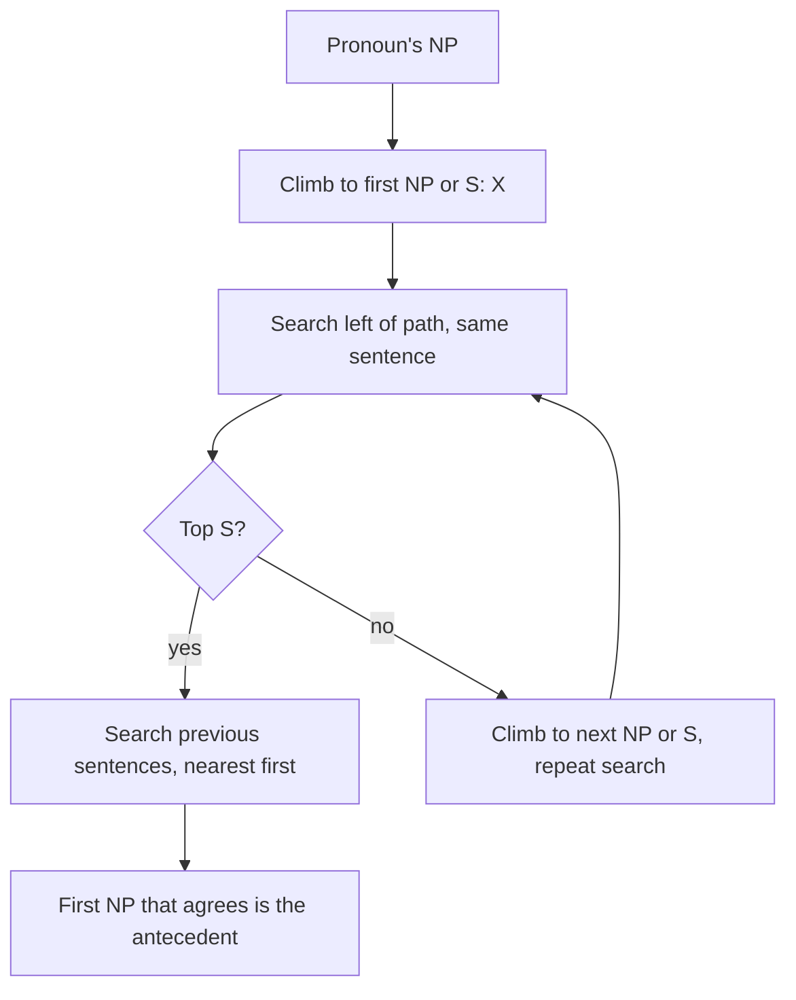

**In simple words:** anaphora resolution ye dhoondhta hai ki pronoun pehle ke kis phrase ki taraf point kar raha hai. Do classic methods hain: Hobbs ka algorithm, jo **parse tree mein chalke** antecedent dhoondhta hai, aur Centering, jo **text kis baare mein hai** ye track karta hai. (Question mein "Cantering" likha hai, matlab Centering.) <Cite id="anaphora-resolution-tp-nlp" /> <Cite id="anaphora-resolution-hobbs1978" />

**Hobbs' algorithm (1978).** Ye sirf syntax aur agreement use karta hai. Ye current aur pichhle sentences ke parse trees mein fixed order se search karta hai aur pehla noun phrase (NP) propose karta hai jo gender aur number mein agree kare. Steps:

1. Pronoun ke NP node se shuru karo.
2. Upar jaake pehle NP ya S node tak jao. Use X kaho, aur path ko p.
3. X ke neeche, p ke left mein, left to right, breadth-first search karo. Koi bhi NP propose karo jiske aur X ke beech ek aur NP ya S ho.
4. Agar X sentence ka top S hai, to pichhle sentences mein search karo, sabse recent pehle, left to right, breadth-first, aur jo bhi NP mile use propose karo. Warna aage badho.
5. X se upar agle NP ya S tak jao. Use X kaho.
6. Agar X ek NP hai aur p uske neeche ke N-bar se nahi guzra, to X propose karo.
7. X ke neeche, p ke left mein search karo aur koi bhi NP propose karo.
8. Agar X ek S hai, to p ke right mein search karo (lekin kisi NP ya S ke neeche mat jao) aur NPs propose karo.
9. Step 4 pe jao.

<Cite id="anaphora-resolution-hobbs1978" loc="diagram" />

*Example:* "John saw a car. He bought it." *He* ke liye X top S hai, left mein kuch nahi, to pichhla sentence search karo: pehla NP *John* hai, jo agree karta hai (male, singular). *it* ke liye *John* agreement mein fail hota hai, to agla NP, *a car*, chuna jata hai.

**Centering theory (Grosz, Joshi, Weinstein 1995).** Har sentence (utterance) ke paas hota hai:

- **Cf** (forward-looking centers): wo entities jo usme mention hui hain, rank: subject > object > others.
- **Cb** (backward-looking center): pichhle Cf ki sabse high-ranked entity jo is sentence mein aayi. Ye "hum kis baare mein baat kar rahe hain" hai.

**Rule 1:** agar koi entity pronoun se refer ho rahi hai, to Cb pronoun hona chahiye. **Rule 2:** transitions ko is order mein prefer karo: Continue > Retain > Smooth-shift > Rough-shift. Wo antecedent chuno jo best transition de. <Cite id="anaphora-resolution-bfp1987" /> <Cite id="discourse-reference-grosz1995" />

*Example:* U1 "John went to the store." (Cf = John, store). U2 "He bought milk." *He* = John, kyunki John Cf(U1) ke top pe hai, isliye wo U2 ka Cb banta hai aur focus John pe rehta hai (agar U3 bhi John ke baare mein ho to Continue).

| Point | Hobbs | Centering |
|---|---|---|
| Uses | Parse tree | Discourse focus |
| Scope | Ek time pe ek pronoun | Poore text ka flow |
| Needs | Parser | Parsed ya tagged utterances |

**Conclusion:** Hobbs antecedent ko fixed tree search se dhoondhta hai; Centering wo antecedent chunta hai jo discourse focus ko smooth rakhe.
