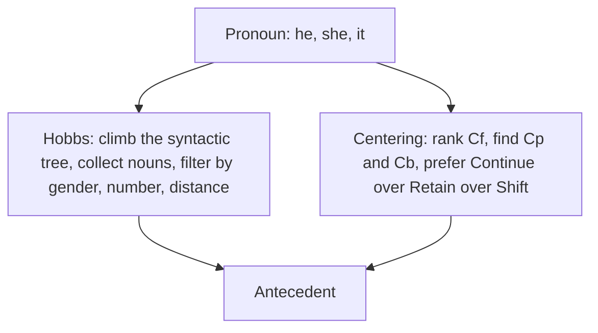

**In simple words:** anaphora resolution links a pronoun to the earlier noun it stands for. The Hobbs algorithm does this by **searching the syntactic tree**; the Centering algorithm does it by **following the focus of the discourse**. (The paper writes "Cantering", meaning Centering.) <Cite id="class-nlp-asol" loc="p. 1" />

**1. Hobbs algorithm** is a heuristic method for pronoun resolution, developed by Jerry Hobbs in 1976. It uses the syntactic tree. *Steps:* start at the pronoun and move up, checking the same level and the level above for nouns; consider each noun found; apply constraints (gender, number agreement, distance); if no suitable antecedent is found, repeat. *Example:* "John saw Mary, he greeted her." The nouns Mary and John are found; *he* is male, so he = John. <Cite id="class-nlp-asol" loc="p. 3" /> <Cite id="class-nlp-asol" loc="p. 4" />

**2. Centering algorithm** tracks the focus of discourse. Each sentence has forward-looking centers (**Cf**, ranked, subject first), a preferred center (**Cp**, usually the subject) and a backward-looking center (**Cb**, the entity carried from the previous sentence). The transitions are **Continue** (preferred), **Retain** and **Shift**, and the algorithm prefers the antecedent that keeps the focus. *Example:* "Aragorn picked up the sword. He looked at Frodo." *He* = Aragorn. <Cite id="class-nlp-asol" loc="p. 2" /> <Cite id="class-nlp-asol" loc="p. 3" />

| Point | Hobbs | Centering |
|---|---|---|
| Idea | search the syntactic tree | track the discourse focus |
| Needs | parse tree | Cf, Cp, Cb of each sentence |
| Chooses by | gender, number, distance | continuity: Continue, Retain, Shift |

**Conclusion:** Hobbs gives a quick tree-based answer for one pronoun; Centering uses the flow of the whole text.
