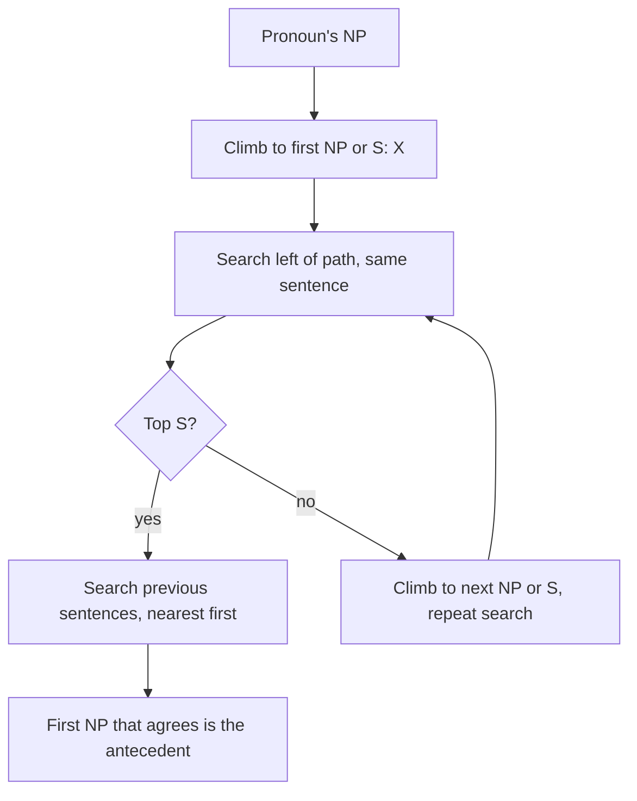

**In simple words:** anaphora resolution finds which earlier phrase a pronoun refers to. Two classic methods are Hobbs' algorithm, which **walks the parse tree** to find the antecedent, and Centering, which tracks **what the text is about**. (The question writes "Cantering", meaning Centering.) <Cite id="anaphora-resolution-tp-nlp" /> <Cite id="anaphora-resolution-hobbs1978" />

**Hobbs' algorithm (1978).** It uses only syntax and agreement. It searches the parse trees of the current and earlier sentences in a fixed order and proposes the first noun phrase (NP) that agrees in gender and number. Steps:

1. Start at the NP node of the pronoun.
2. Go up to the first NP or S node. Call it X, and the path p.
3. Search below X, left of p, left to right, breadth-first. Propose any NP that has another NP or S between it and X.
4. If X is the top S of the sentence, search earlier sentences, most recent first, left to right, breadth-first, and propose any NP found. Otherwise continue.
5. Go up from X to the next NP or S. Call it X.
6. If X is an NP and p did not pass through the N-bar below it, propose X.
7. Search below X, left of p, and propose any NP.
8. If X is an S, search right of p (but not below any NP or S) and propose NPs.
9. Go to step 4.

<Cite id="anaphora-resolution-hobbs1978" loc="diagram" />

*Example:* "John saw a car. He bought it." For *He*, X is the top S, nothing to the left, so search the previous sentence: first NP is *John*, which agrees (male, singular). For *it*, *John* fails agreement, so the next NP, *a car*, is chosen.

**Centering theory (Grosz, Joshi, Weinstein 1995).** Each sentence (utterance) has:

- **Cf** (forward-looking centers): the entities it mentions, ranked subject > object > others.
- **Cb** (backward-looking center): the highest-ranked entity of the previous Cf that appears in this sentence. It is "what we are talking about".

**Rule 1:** if any entity is referred to by a pronoun, the Cb must be a pronoun. **Rule 2:** prefer transitions in the order Continue > Retain > Smooth-shift > Rough-shift. Choose the antecedent that gives the best transition. <Cite id="anaphora-resolution-bfp1987" /> <Cite id="discourse-reference-grosz1995" />

*Example:* U1 "John went to the store." (Cf = John, store). U2 "He bought milk." *He* = John, since John is the top of Cf(U1), so he becomes the Cb of U2 and the focus stays on John (a Continue if U3 keeps talking about John).

| Point | Hobbs | Centering |
|---|---|---|
| Uses | Parse tree | Discourse focus |
| Scope | One pronoun at a time | Whole text flow |
| Needs | Parser | Parsed or tagged utterances |

**Conclusion:** Hobbs finds the antecedent by a fixed tree search; Centering picks the antecedent that keeps the discourse focus smooth.
