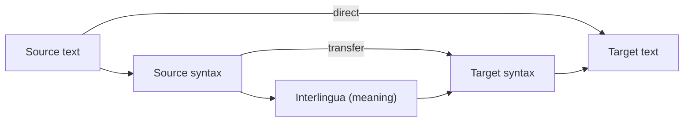

**In simple words:** machine translation (MT) system text ko source language (jaise English) se target language (jaise Hindi) mein automatically translate karta hai. <Cite id="nlp-applications-gfg-mt" /> <Cite id="pyq-2025-05-slp3-mt" />

**Kyun mushkil hai:** word order alag hota hai (English: subject-verb-object, Hindi: subject-object-verb), words ke kai senses hote hain, aur idioms word by word translate nahi hote.

**MT systems ke types:**

1. **Rule-based MT (RBMT).** Linguists ke likhe dictionaries aur grammar rules use karta hai. Teen kinds: **direct** (word by word, reordering ke saath), **transfer** (source analyse karo, structure badlo, target generate karo) aur **interlingua** (language-free meaning mein convert karo, phir generate karo). <Cite id="nlp-applications-wiki-rbmt" />
2. **Statistical MT (SMT).** Bade parallel corpus (same text do languages mein) se seekhta hai. Noisy-channel idea: wo target sentence $e$ chuno jo $P(f \mid e)\,P(e)$ maximise kare, jahan $P(f \mid e)$ translation model hai (word aur phrase alignments) aur $P(e)$ fluent output ke liye language model. <Cite id="nlp-applications-ibm1993" />
3. **Neural MT (NMT).** Encoder source sentence ko vectors mein padhta hai aur decoder target sentence word by word likhta hai, attention ke saath taaki sahi source words dekhe. Aaj ka standard yahi hai, ab Transformer pe based. <Cite id="pyq-2025-05-slp3-mt" loc="Ch. 13" />

<Cite id="nlp-applications-wiki-rbmt" loc="diagram" />

**Typical NMT pipeline ka working (example "I eat rice"):**

1. Tokenize karo aur subwords mein todo: I | eat | rice.
2. Encoder har token ko context ke saath vector mein badalta hai.
3. Decoder, attention ke saath, target tokens ek ek karke banata hai: main | chawal | khata hoon (Hindi, Roman letters mein).
4. Detokenize karke output do.

| Type | Kya chahiye | Strength | Weakness |
|---|---|---|---|
| Rule-based | Linguists ke rules | Predictable | Costly, sab kuch cover karna mushkil |
| Statistical | Parallel corpus | Khud seekhta hai | Word order kamzor, bahut saari tables |
| Neural | Bada corpus, GPU | Sabse fluent | Bahut data chahiye, hallucinate kar sakta hai |

**Evaluation:** BLEU output ko human references se compare karta hai.

**Conclusion:** MT rules se statistics aur phir neural networks tak aaya; attention wale neural encoder-decoder models ab best translations dete hain.
