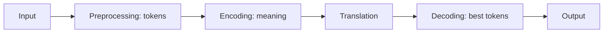

**In simple words:** machine translation (MT) NLP se text ya speech ko ek language se dusri mein automatically translate karna hai, bina kisi insaan ke har sentence translate kiye. <Cite id="class-nlp-m6" loc="slide 1" /><Cite id="class-nlp-asol" loc="p. 6" />

**Working** (modern systems Neural MT use karte hain): <Cite id="class-nlp-m6" loc="slide 2" />

1. **Input:** source language mein text ya speech.
2. **Preprocessing:** input clean karo aur tokens mein baanto.
3. **Encoding:** neural model source sentence ka meaning aur context pakadta hai.
4. **Translation:** model target-language text generate karta hai.
5. **Decoding:** target tokens ka sabse suitable sequence chuno.
6. **Output:** translation user ko dikhao.

Transformer systems mein **attention** model ko translation ka har hissa banate waqt source ke relevant part pe focus karne deta hai.

**Methods:** (1) **Rule-based (RBMT):** haath se bane grammar rules, bilingual dictionaries, morphological analysis aur transfer rules. (2) **Statistical (SMT):** parallel corpora se seekhi probabilities, IBM models, language models aur phrase-based models ke saath. (3) **Neural (NMT):** deep networks translation seedha data se seekhte hain: RNN, LSTM, GRU, encoder-decoder, attention aur Transformer. (4) **Transformer-based:** self-attention, parallel processing aur context-aware translation. <Cite id="class-nlp-m6" loc="slides 3-6" />

**Evaluation:** BLEU (reference translations se similarity), ROUGE (overlapping sequences), METEOR (word matches, stems, synonyms) aur human evaluation (fluency, accuracy, meaning). <Cite id="class-nlp-m6" loc="slide 6" />

**Applications:** website aur app localization, business communication, travel, education, multilingual customer support, subtitles aur captions. <Cite id="class-nlp-m6" loc="slide 7" />

| Advantages | Limitations |
|---|---|
| fast, scalable, consistent, 24/7, cost-effective | context errors, cultural differences (idioms, humor), kuch languages ka data kam, domain errors, human judgment nahi |

<Cite id="class-nlp-m6" loc="slide 8" />

**Conclusion:** modern MT neural aur Transformer based hai, fast aur sasta, par mushkil text ke liye abhi bhi human review chahiye.
