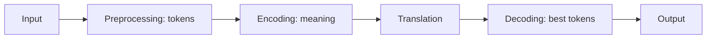

**In simple words:** machine translation (MT) is the use of NLP to translate text or speech from one language to another automatically, without a person translating every sentence. <Cite id="class-nlp-m6" loc="slide 1" /><Cite id="class-nlp-asol" loc="p. 6" />

**Working** (modern systems use Neural MT): <Cite id="class-nlp-m6" loc="slide 2" />

1. **Input:** text or speech in the source language.
2. **Preprocessing:** clean the input and divide it into tokens.
3. **Encoding:** a neural model captures the meaning and context of the source sentence.
4. **Translation:** the model generates the target-language text.
5. **Decoding:** select the most suitable sequence of target tokens.
6. **Output:** show the translation to the user.

In Transformer systems, **attention** lets the model focus on the relevant part of the source while generating each part of the translation.

**Methods:** (1) **Rule-based (RBMT):** hand-made grammar rules, bilingual dictionaries, morphological analysis and transfer rules. (2) **Statistical (SMT):** probabilities learned from parallel corpora, with IBM models, language models and phrase-based models. (3) **Neural (NMT):** deep networks learn translation directly from data: RNN, LSTM, GRU, encoder-decoder, attention and Transformer. (4) **Transformer-based:** self-attention, parallel processing and context-aware translation. <Cite id="class-nlp-m6" loc="slides 3-6" />

**Evaluation:** BLEU (similarity with reference translations), ROUGE (overlapping sequences), METEOR (word matches, stems, synonyms) and human evaluation of fluency, accuracy and meaning. <Cite id="class-nlp-m6" loc="slide 6" />

**Applications:** website and app localization, business communication, travel, education, multilingual customer support, subtitles and captions. <Cite id="class-nlp-m6" loc="slide 7" />

| Advantages | Limitations |
|---|---|
| fast, scalable, consistent, available 24/7, cost-effective | context errors, cultural differences (idioms, humor), little data for some languages, domain errors, no human judgment |

<Cite id="class-nlp-m6" loc="slide 8" />

**Conclusion:** modern MT is neural and Transformer based, fast and cheap, but still needs human review for difficult text.
