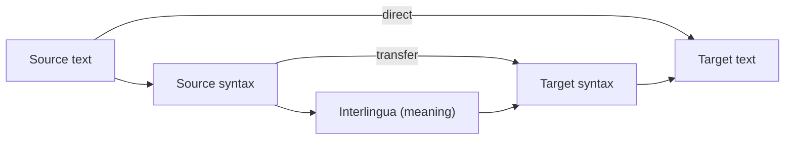

**In simple words:** a machine translation (MT) system translates text from a source language (for example English) to a target language (for example Hindi) automatically. <Cite id="nlp-applications-gfg-mt" /> <Cite id="pyq-2025-05-slp3-mt" />

**Why it is hard:** word order differs (English: subject-verb-object, Hindi: subject-object-verb), words have many senses, and idioms do not translate word by word.

**Types of MT systems:**

1. **Rule-based MT (RBMT).** Uses dictionaries and grammar rules written by linguists. Three kinds: **direct** (word by word with reordering), **transfer** (analyse the source, transform the structure, generate the target) and **interlingua** (convert to a language-free meaning, then generate). <Cite id="nlp-applications-wiki-rbmt" />
2. **Statistical MT (SMT).** Learns from a large parallel corpus (same text in two languages). The noisy-channel idea: choose the target sentence $e$ that maximises $P(f \mid e)\,P(e)$, where $P(f \mid e)$ is the translation model (word and phrase alignments) and $P(e)$ is the language model for fluent output. <Cite id="nlp-applications-ibm1993" />
3. **Neural MT (NMT).** An encoder reads the source sentence into vectors and a decoder writes the target sentence word by word, with attention to look at the right source words. This is today's standard, now based on the Transformer. <Cite id="pyq-2025-05-slp3-mt" loc="Ch. 13" />

<Cite id="nlp-applications-wiki-rbmt" loc="diagram" />

**Working of a typical NMT pipeline (example "I eat rice"):**

1. Tokenize and split into subwords: I | eat | rice.
2. Encoder converts each token into a vector with context.
3. Decoder, with attention, produces target tokens one by one: main | chawal | khata hoon (Hindi, in Roman letters).
4. Detokenize and output.

| Type | Needs | Strength | Weakness |
|---|---|---|---|
| Rule-based | Linguists' rules | Predictable | Costly, hard to cover everything |
| Statistical | Parallel corpus | Learns automatically | Poor word order, lots of tables |
| Neural | Large corpus, GPU | Most fluent | Needs much data, may hallucinate |

**Evaluation:** BLEU compares the output with human references.

**Conclusion:** MT moved from rules to statistics to neural networks; neural encoder-decoder models with attention now give the best translations.
