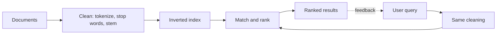

**In simple words:** Information Retrieval (IR) system documents ke bade collection mein se wo documents dhoondhta hai jo user ki maang se sabse achhe match karein. Web search (Google) sabse jaana-mana example hai. <Cite id="nlp-applications-gfg-ir" /> <Cite id="nlp-applications-tp-ir" />

**Key terms:** *document* (web page, mail, article), *collection* (saare documents), *query* (user ke words), *relevance* (document query ka kitna achha jawab deta hai).

**Components aur working:**

1. **Document processing:** tokenize, stop words hatao, stem karo.
2. **Indexing:** **inverted index** banao, ek table jo har term se un documents ki list tak jaati hai jinme wo hai. Phir search ke liye saare documents scan nahi karne padte.
3. **Query processing:** query pe wahi cleaning lagao.
4. **Matching aur ranking:** har candidate document ko score do, aam taur par **tf-idf** se (word tab important hai jab document mein frequent ho lekin collection mein rare) aur query aur document vectors ke beech cosine similarity se. <Cite id="nlp-applications-wiki-tfidf" /> <Cite id="nlp-applications-slp3-11" loc="Ch. 11" />
5. **Output aur feedback:** ranked list dikhao; clicks ya relevance feedback aage ke results sudhaar sakte hain.

<Cite id="nlp-applications-gfg-ir" loc="diagram" />

**Models:** Boolean (documents AND, OR, NOT se match hote hain), vector space (tf-idf aur cosine), probabilistic (BM25).

**Evaluation:** precision = return hue relevant results / return hue results. Recall = return hue relevant results / saare relevant documents. Example: 10 mein se 8 results relevant hain, aur 20 relevant documents hain, to precision = 0.8 aur recall = 8/20 = 0.4.

| Point | IR | Database query |
|---|---|---|
| Data | Unstructured text | Structured tables |
| Result | Ranked, approximate | Exact |

**Applications:** search engines, digital libraries, e-mail search, recommendation.

**Challenges:** synonyms (*car* aur *automobile*), ambiguity, spelling errors, bahut bade collections.

**Conclusion:** IR system documents ko offline index karta hai aur query aane par unhe match aur rank karke sabse relevant results pehle deta hai.
