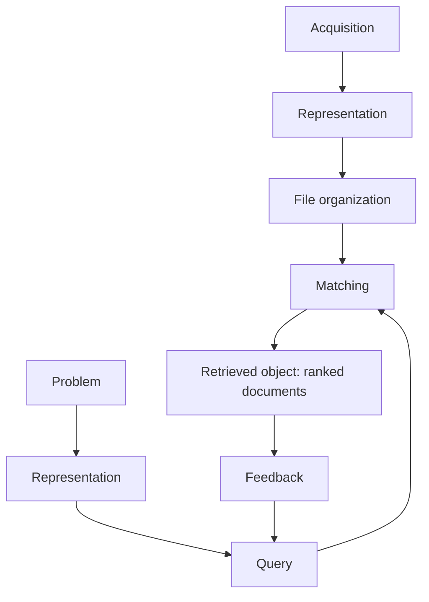

**In simple words:** information retrieval (IR) system wo documents dhoondhta hai jo aapki search se match hote hain aur best pehle dikhata hai. Ye smart librarian jaisa hai jo answer nahi deta par batata hai kaun si book padhni hai. <Cite id="class-nlp-m6" loc="slide 9" />

**Definition:** Information Retrieval (IR) helps to find relevant information from large collections of documents. Ye ek software program hai jo documents ki information ke organization, storage, retrieval aur evaluation ko handle karta hai. Ye query ko documents se **matching function** se compare karta hai, jo har document ko **retrieval status value (RSV)** deta hai, ranking ke liye. Documents ko **descriptors** se represent karte hain, yaani vocabulary ke sabse important keywords. <Cite id="class-nlp-m6" loc="slide 9" />

**Components** <Cite id="class-nlp-m6" loc="slides 10-14" />

- **User side:** *problem identification* (student ko machine learning seekhni hai), *representation* (need ko query banana, "machine learning basics"), *query* (submit karna) aur *feedback* (results dekhkar search refine karna).
- **System side:** *acquisition* (documents collect karna, web crawlers se), *representation* (har document ko keywords se describe karna, indexing), *file organization* (sequential, ya inverted: har term ke neeche records ki list), *matching* (query aur documents compare) aur *retrieved object* (ranked documents return).
- **Interaction:** user results dekhta hai aur feedback deta hai; system updated query process karke behtar results laata hai.

**Conclusion:** IR query ke liye relevant documents ki ranked list deta hai; user ka feedback agli search behtar banata hai.
