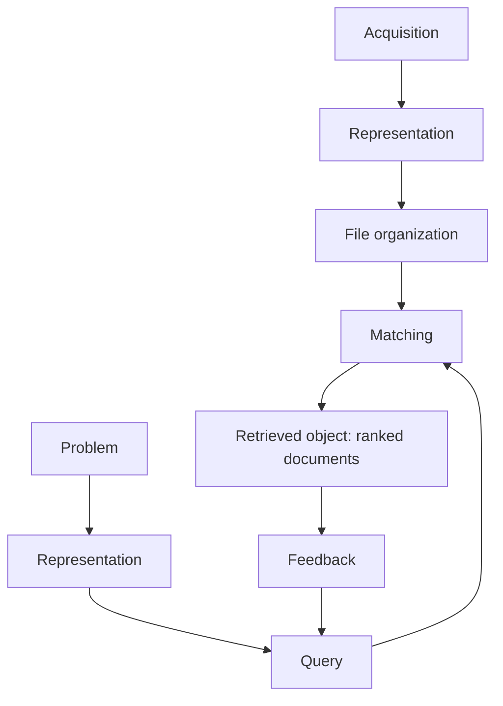

**In simple words:** an information retrieval (IR) system finds the documents that match what you search for and shows the best ones first. It is like a smart librarian who does not give you the answer but tells you which book to read. <Cite id="class-nlp-m6" loc="slide 9" />

**Definition:** Information Retrieval (IR) helps to find relevant information from large collections of documents. It is a software program that deals with the organization, storage, retrieval and evaluation of information from documents. It compares the query with the documents using a **matching function**, which gives each document a **retrieval status value (RSV)** used for ranking. Documents are represented by **descriptors**, the most important keywords of the vocabulary. <Cite id="class-nlp-m6" loc="slide 9" />

**Components** <Cite id="class-nlp-m6" loc="slides 10-14" />

- **User side:** *problem identification* (a student wants to learn machine learning), *representation* (turn the need into a query, "machine learning basics"), *query* (submit it) and *feedback* (refine the search after seeing results).
- **System side:** *acquisition* (collect documents, using web crawlers), *representation* (describe each document by keywords, called indexing), *file organization* (sequential, or inverted: a list of records under each term), *matching* (compare query and documents) and *retrieved object* (return the ranked documents).
- **Interaction:** the user reviews the results and gives feedback; the system processes the updated query and retrieves better results.

**Conclusion:** IR returns a ranked list of relevant documents for a query; feedback from the user makes the next search better.
