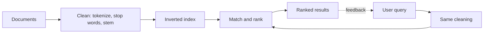

**In simple words:** an Information Retrieval (IR) system finds, from a large collection of documents, the documents that best match what a user asks for. Web search (Google) is the best known example. <Cite id="nlp-applications-gfg-ir" /> <Cite id="nlp-applications-tp-ir" />

**Key terms:** *document* (a web page, mail, article), *collection* (all documents), *query* (the user's words), *relevance* (how well a document answers the query).

**Components and working:**

1. **Document processing:** tokenize, remove stop words, stem.
2. **Indexing:** build an **inverted index**, a table from each term to the list of documents holding it. Searching then needs no scan of all documents.
3. **Query processing:** apply the same cleaning to the query.
4. **Matching and ranking:** score each candidate document, commonly by **tf-idf** (a word is important if it is frequent in the document but rare in the collection) and cosine similarity between query and document vectors. <Cite id="nlp-applications-wiki-tfidf" /> <Cite id="nlp-applications-slp3-11" loc="Ch. 11" />
5. **Output and feedback:** show the ranked list; clicks or relevance feedback can improve later results.

<Cite id="nlp-applications-gfg-ir" loc="diagram" />

**Models:** Boolean (documents match with AND, OR, NOT), vector space (tf-idf and cosine), probabilistic (BM25).

**Evaluation:** precision = relevant results returned / results returned. Recall = relevant results returned / all relevant documents. Example: 8 of 10 results are relevant, and 20 relevant documents exist, so precision = 0.8 and recall = 8/20 = 0.4.

| Point | IR | Database query |
|---|---|---|
| Data | Unstructured text | Structured tables |
| Result | Ranked, approximate | Exact |

**Applications:** search engines, digital libraries, e-mail search, recommendation.

**Challenges:** synonyms (*car* and *automobile*), ambiguity, spelling errors, huge collections.

**Conclusion:** an IR system indexes documents offline and, for a query, matches and ranks them to give the most relevant results first.
