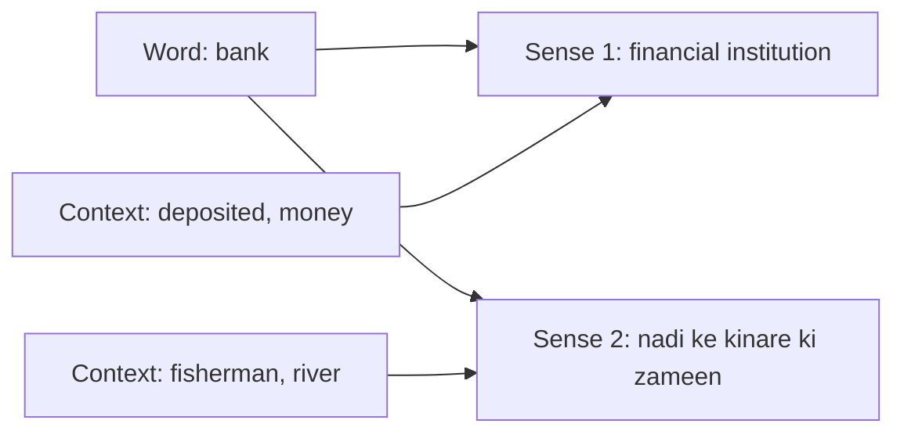

**In simple words:** bahut se words ke ek se zyaada meanings hote hain, aur WSD wo meaning dhundhta hai jo sentence mein fit baithe. <Cite id="class-nlp-pyq4" loc="p. 5" />

**Definition:** Word Sense Disambiguation (WSD) us word ki sahi meaning tay karne par focus karta hai jiske kai possible interpretations hain. Bahut se words ambiguous hote hain: jis context mein use ho, uske hisaab se meaning badalti hai. <Cite id="class-nlp-pyq4" loc="p. 5" />

**Example:** word *bank*. <Cite id="class-nlp-pyq4" loc="p. 5" />

- "She deposited money in the bank." Yahan bank financial institution hai.
- "The fisherman sat on the river bank." Yahan bank nadi ke kinare ki zameen hai.

**Zaroorat:** WSD NLP system ko aas-paas ke words analyze karke intended sense dhundhne deta hai, jisse language understanding behtar hoti hai aur ambiguity kam hoti hai. <Cite id="class-nlp-pyq4" loc="p. 5" />

**Methods:** knowledge-based (dictionary overlap, Lesk's algorithm) <Cite id="class-nlp-pyq4" loc="p. 5" /> aur semi-supervised (Yarowsky bootstrapping). <Cite id="class-nlp-pyq4" loc="p. 7" />

**Conclusion:** WSD context se ambiguous word ka sahi sense dhundhta hai.
