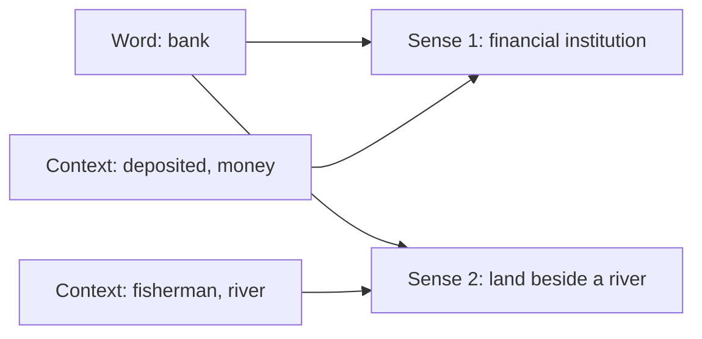

**In simple words:** many words have more than one meaning, and WSD finds the meaning that fits the sentence. <Cite id="class-nlp-pyq4" loc="p. 5" />

**Definition:** Word Sense Disambiguation (WSD) focuses on determining the correct meaning of a word when it has multiple possible interpretations. Many words are ambiguous: their meaning changes with the context in which they are used. <Cite id="class-nlp-pyq4" loc="p. 5" />

**Example:** the word *bank*. <Cite id="class-nlp-pyq4" loc="p. 5" />

- "She deposited money in the bank." Here bank is a financial institution.
- "The fisherman sat on the river bank." Here bank is the land beside a river.

**Need:** WSD lets an NLP system analyze the surrounding words and find the intended sense, which improves language understanding and reduces ambiguity. <Cite id="class-nlp-pyq4" loc="p. 5" />

**Methods:** knowledge-based (dictionary overlap, Lesk's algorithm) <Cite id="class-nlp-pyq4" loc="p. 5" /> and semi-supervised (Yarowsky bootstrapping). <Cite id="class-nlp-pyq4" loc="p. 7" />

**Conclusion:** WSD finds the right sense of an ambiguous word from its context.
