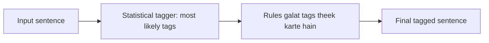

**In simple words:** hybrid tagger dono ideas, rules aur probabilities, ko mila deta hai, taaki har ek doosre ki kamzori cover kare.

**Definition:** hybrid POS tagging rule-based aur stochastic (statistical) methods ko ek hi tagger mein milata hai. (Class answers dono parts batate hain: rule-based tagging, <Cite id="class-nlp-pyq3" loc="p. 3" />, aur HMM / MaxEnt tagging, <Cite id="class-nlp-pyq3" loc="p. 2" /> <Cite id="class-nlp-pyq3" loc="p. 8" />.)

**Kaise kaam karta hai (ek common tareeka):**

1. Statistical step har word ko uska sabse likely tag deta hai.
2. Phir rules word endings aur context se galtiyan theek karte hain.

Dono parts ulte order mein bhi use ho sakte hain: pehle rules impossible tags hatate hain, phir statistics bacho mein se chunti hai.

**Advantage:** statistics ki accuracy aur rules ka control aur clarity. **Disadvantage:** banana zyaada complex hai.

**Conclusion:** hybrid tagger behtar tagging ke liye rules aur probabilities saath use karta hai.
