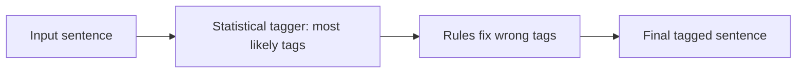

**In simple words:** a hybrid tagger mixes the two ideas, rules and probabilities, so each covers the other's weakness.

**Definition:** hybrid POS tagging combines rule-based and stochastic (statistical) methods in one tagger. (The class answers describe the two parts: rule-based tagging, <Cite id="class-nlp-pyq3" loc="p. 3" />, and HMM / MaxEnt tagging, <Cite id="class-nlp-pyq3" loc="p. 2" /> <Cite id="class-nlp-pyq3" loc="p. 8" />.)

**How it works (one common way):**

1. A statistical step gives every word its most likely tag.
2. Rules then correct the mistakes using the word endings and the context.

The two parts can also be used the other way round: rules first remove impossible tags, and the statistics choose among the rest.

**Advantage:** accuracy of statistics with the control and clarity of rules. **Disadvantage:** more complex to build.

**Conclusion:** a hybrid tagger uses rules and probabilities together for better tagging.
