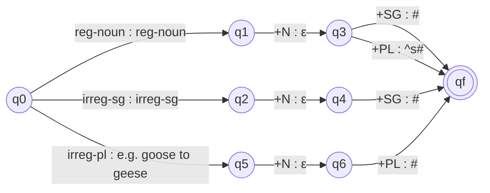

**In simple words:** finite state transducer (FST) finite automaton jaisi machine hai, par har arrow ek symbol padhta hai aur ek symbol likhta bhi hai. Isliye ye ek string ko dusri string mein convert karta hai. Nouns ke liye ye lexical form `fox +N +PL` ko spelling `foxes` mein convert karta hai. <Cite id="morphology-fst-wiki-fst" /> <Cite id="morphology-fst-jm-ch3-notes" />

**Do levels kyun chahiye:** zyada-tar nouns ka plural stem + *s* hota hai (cat, cats), par jo nouns *x, s, z* (aur *ch, sh*) pe end hote hain wo *es* lete hain (fox, foxes), aur irregular nouns andar se badal jaate hain (goose, geese). Ek simple machine ye sab nahi kar sakti, isliye hum do chhote FSTs ek ke baad ek lagate hain. <Cite id="morphology-fst-wiki-plurals" />

**Design**

1. **Lexicon FST** lexical form ko intermediate form mein map karta hai. `^` morpheme boundary hai aur `#` word ka end hai.
2. **Spelling-rule FST** (e-insertion) intermediate form ko surface word mein map karta hai. Rule: jab x, s ya z pe end hone wala stem suffix *s* se milta hai to *e* insert karo.

Yahan *reg-noun* regular stems (cat, dog, fox) ki class hai, *irreg-sg* goose, mouse hai, aur *irreg-pl* geese, mice hai, jo pairs ki tarah store hote hain (lexical goose se surface geese, mouse se mice). <Cite id="morphology-fst-gfg-morph" />

**Spelling-rule FST** (hum x, s, z dikha rahe hain; *church* ke liye ch aur sh ko isi set mein jodo; states q0, q1 accepting; intermediate string padhta hai)

| State | Input | Output | Next state |
|---|---|---|---|
| q0 | other letter | same | q0 |
| q0 | x, s, z | same | q1 |
| q0 | ^ | ε | q0 |
| q0 | # | ε | q0 |
| q1 | x, s, z | same | q1 |
| q1 | other letter | same | q0 |
| q1 | ^ | ε | q2 |
| q1 | # | ε | q0 |
| q2 | ε (kuch nahi padha) | e | q3 |
| q3 | s | s | q4 |
| q4 | # | ε | q0 |

Sirf q1, q2, q3, q4 wala path extra *e* likhta hai.

<Sum>

<Given>

lexical forms `fox +N +PL` aur `cat +N +PL`.

</Given>

<Find>

surface words.

</Find>

<Steps>

1. fox ke liye Lexicon FST: `fox` copy hota hai, `+N` se ε, `+PL` se `^s#`. Intermediate: `fox^s#`. *Reason: regular plural suffix boundary ke baad lagta hai.*
2. `fox^s#` pe Spelling FST: f, o q0 mein rehte hain; x se q1; `^` delete hokar q2; ε:e se q3 mein *e* likha jata hai; s q4 mein copy hota hai; `#` delete hota hai. Output: `foxes`.
3. cat ke liye wahi: intermediate `cat^s#`. Yahan t, x/s/z nahi hai, to `^` q0 se delete hota hai aur e nahi likha jata. Output: `cats`.

</Steps>

<Answer>

`fox +N +PL` se *foxes* banta hai, aur `cat +N +PL` se *cats*.

</Answer>

<Box kind="verify">

Ulta chalao: *foxes* se `fox^s#` (x ke baad e hata diya), phir `fox +N +PL`. Saath mein, fox ke 3 letters hain aur output mein 3 + 2 = 5 hain, yaani stem + *es*. cat ke liye 3 + 1 = 4 letters hain, yaani stem + *s*.

</Box>

</Sum>

**Two-level design ka advantage:** lexicon mein words hain, rules mein spelling hai, aur wahi machine analysis (foxes se fox +N +PL) aur generation dono ke liye chalti hai.

**Conclusion:** lexicon FST aur e-insertion FST milkar regular aur irregular noun plurals handle karte hain.

Exam mein English mein likho: "An FST maps the lexical level to the surface level; a lexicon FST and a spelling-rule FST together generate plural nouns."
