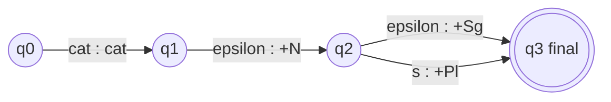

**In simple words:** nouns ka FST noun ki spelling padhta hai aur uska root plus singular ya plural ka tag likhta hai.

**FST:** FSA ka extension jo input sequences ko output sequences se map karta hai; har transition par ek input symbol aur ek output symbol hota hai. $T = (Q, \Sigma, \Gamma, q_0, F)$. <Cite id="class-nlp-pyq2" loc="p. 9" />

**Task:** surface word, phir FST, phir analysis: cats se cat + N + Pl aur cat se cat + N + Sg. <Cite id="class-nlp-pyq2" loc="p. 9" /> <Cite id="class-nlp-pyq2" loc="p. 10" />

| Arc | Input : output | Matlab |
|---|---|---|
| q0 se q1 | cat : cat | Regular noun stem padho aur copy karo |
| q1 se q2 | epsilon : +N | Noun tag likho (koi input nahi padha) |
| q2 se q3 | epsilon : +Sg | Singular: aur kuch padhna nahi |
| q2 se q3 | s : +Pl | Plural: s padho aur plural likho |

**Regular nouns:** cat se cat +N +Sg; cats se cat +N +Pl. **Irregular plural nouns** (standard addition; class files mein nahi hai): ek extra arc mice padhta hai aur mouse +N +Pl likhta hai, kyunki plural s jodkar nahi banta.

**Conclusion:** wahi transducer ulti taraf (analysis se spelling) padhne par nouns generate karta hai.
