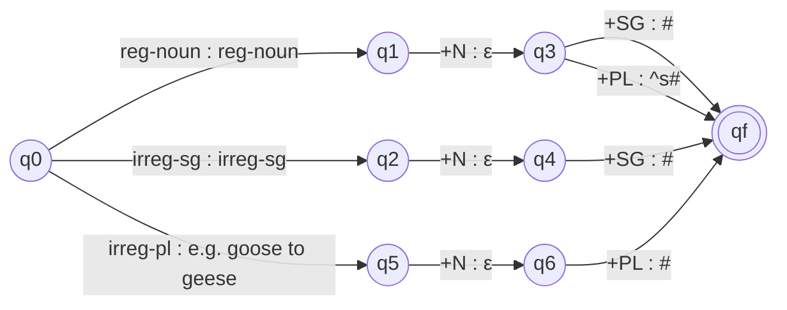

**In simple words:** a finite state transducer (FST) is a machine like a finite automaton, but each arrow reads one symbol and also writes one symbol. So it converts one string into another. For nouns, it converts a lexical form such as `fox +N +PL` into the spelling `foxes`. <Cite id="morphology-fst-wiki-fst" /> <Cite id="morphology-fst-jm-ch3-notes" />

**Why two levels are needed:** the plural of most nouns is stem + *s* (cat, cats), but nouns ending in *x, s, z* (also *ch, sh*) take *es* (fox, foxes), and irregular nouns change inside (goose, geese). One simple machine cannot do all of this, so we use two small FSTs in a row. <Cite id="morphology-fst-wiki-plurals" />

**Design**

1. **Lexicon FST** maps the lexical form to an intermediate form. `^` marks a morpheme boundary and `#` marks the word end.
2. **Spelling-rule FST** (e-insertion) maps the intermediate form to the surface word. Rule: insert *e* when a stem ending in x, s or z meets the suffix *s*.

Here *reg-noun* is a class of regular stems (cat, dog, fox), *irreg-sg* is goose, mouse, and *irreg-pl* is geese, mice, stored as pairs (lexical goose goes to surface geese, mouse to mice). <Cite id="morphology-fst-gfg-morph" />

**Spelling-rule FST** (we show x, s, z; add ch and sh to the same set for *church*; states q0, q1 accepting; reads the intermediate string)

| State | Input | Output | Next state |
|---|---|---|---|
| q0 | other letter | same | q0 |
| q0 | x, s, z | same | q1 |
| q0 | ^ | ε | q0 |
| q0 | # | ε | q0 |
| q1 | x, s, z | same | q1 |
| q1 | other letter | same | q0 |
| q1 | ^ | ε | q2 |
| q1 | # | ε | q0 |
| q2 | ε (nothing read) | e | q3 |
| q3 | s | s | q4 |
| q4 | # | ε | q0 |

The path q1, q2, q3, q4 is the only one that writes an extra *e*.

<Sum>

<Given>

lexical forms `fox +N +PL` and `cat +N +PL`.

</Given>

<Find>

the surface words.

</Find>

<Steps>

1. Lexicon FST for fox: `fox` is copied, `+N` gives ε, `+PL` gives `^s#`. Intermediate: `fox^s#`. *Reason: the regular plural suffix is added after a boundary.*
2. Spelling FST on `fox^s#`: f, o stay in q0; x moves to q1; `^` is deleted and moves to q2; ε:e writes *e* in q3; s is copied in q4; `#` is deleted. Output: `foxes`.
3. Same for cat: intermediate `cat^s#`. Here t is not x, s or z, so `^` is deleted from q0 and no e is written. Output: `cats`.

</Steps>

<Answer>

`fox +N +PL` becomes *foxes*, and `cat +N +PL` becomes *cats*.

</Answer>

<Box kind="verify">

Run it backwards: *foxes* gives `fox^s#` (e removed after x), then `fox +N +PL`. Also fox has 3 letters and the output has 3 + 2 = 5, which is stem + *es*. For cat, 3 + 1 = 4 letters, which is stem + *s*.

</Box>

</Sum>

**Advantage of the two-level design:** the lexicon holds words, the rules hold spelling, and the same machine works for both analysis (foxes to fox +N +PL) and generation.

**Conclusion:** a lexicon FST plus an e-insertion FST handles regular and irregular noun plurals.
