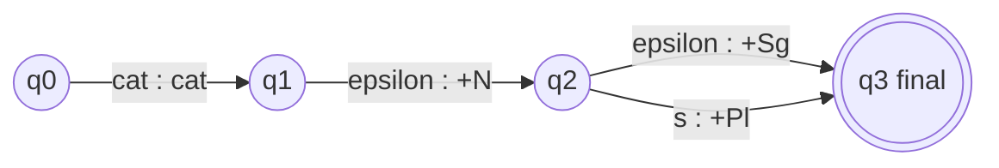

**In simple words:** an FST for nouns reads the spelling of a noun and writes its root plus a tag for singular or plural.

**FST:** an extension of an FSA that maps input sequences to output sequences; every transition has an input symbol and an output symbol. $T = (Q, \Sigma, \Gamma, q_0, F)$. <Cite id="class-nlp-pyq2" loc="p. 9" />

**Task:** surface word, then FST, then analysis: cats gives cat + N + Pl and cat gives cat + N + Sg. <Cite id="class-nlp-pyq2" loc="p. 9" /> <Cite id="class-nlp-pyq2" loc="p. 10" />

| Arc | Input : output | Meaning |
|---|---|---|
| q0 to q1 | cat : cat | Read the regular noun stem and copy it |
| q1 to q2 | epsilon : +N | Write the noun tag (no input read) |
| q2 to q3 | epsilon : +Sg | Singular: nothing more to read |
| q2 to q3 | s : +Pl | Plural: read the s and write plural |

**Regular nouns:** cat gives cat +N +Sg; cats gives cat +N +Pl. **Irregular plural nouns** (a standard addition; the class files do not draw it): one extra arc reads mice and writes mouse +N +Pl, because the plural is not made by adding s.

**Conclusion:** the same transducer read the other way (from analysis to spelling) generates the nouns.
