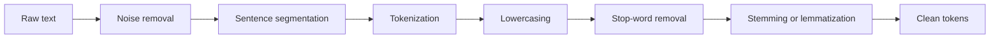

**In simple words:** raw text messy hota hai: capital letters, punctuation, tags, alag word forms. Preprocessing use clean karta hai aur ek regular form mein todta hai, taaki aage ke steps (tagging, parsing, classification) behtar kaam karein. <Cite id="text-preprocessing-gfg-pre" /> <Cite id="text-preprocessing-av-pre" />

**Kyun zaroori hai:** computer *Cats*, *cats* aur *cat* ko alag strings maanta hai, aur punctuation ya HTML noise badhate hain. Cleaning se milti-julti cheezein ek jaisi dikhti hain aur vocabulary chhoti hoti hai.

<Cite id="text-preprocessing-gfg-pre" loc="diagram" />

| Operation | Kya karta hai | Example |
|---|---|---|
| Noise removal | HTML tags, URLs, symbols, extra spaces hatata hai | `<b>Hi</b>!` se `Hi` |
| Sentence segmentation | Text ko ., ?, ! pe sentences mein todta hai ("Dr." ka dhyan rakho) | ek paragraph se do sentences |
| Tokenization | Sentence ko words ya tokens mein todta hai <Cite id="text-preprocessing-slp3-ch2" /> | "don't" se `do`, `n't` |
| Lowercasing | Saare letters chhote karta hai | `The` se `the` |
| Stop-word removal | Bahut common, kam meaning wale words hatata hai <Cite id="text-preprocessing-gfg-stop" /> | *the, is, in* hatao |
| Stemming | Rules se suffix kaat deta hai, non-words aa sakte hain | `running` se `run` |
| Lemmatization | Grammar use karke dictionary base form deta hai | `better` se `good` <Cite id="text-preprocessing-ibm-stemlem" /> |

**Worked example.** Input: "The cats were running quickly in the garden!"

1. Lowercase karo aur punctuation hatao: `the cats were running quickly in the garden`.
2. Tokenize: [the, cats, were, running, quickly, in, the, garden].
3. Stop words hatao (the, were, in, the): [cats, running, quickly, garden].
4. Stem (Porter): [cat, run, quickli, garden]. Lemmatize karne pe (ye jaante hue ki *running* verb hai): [cat, run, quickly, garden].

Dhyan do ki stemmer ne non-word *quickli* diya, jabki lemmatization ne asli word rakha.

**Savdhaniyan:** jahan stop words matter karte hain wahan unhe mat hatao (jaise sentiment mein "not"), aur jahan case meaning deta hai wahan lowercase mat karo (*Apple* company).

**Conclusion:** preprocessing messy text ko clean, uniform token list banata hai; steps task ke hisaab se chune jaate hain.

Exam mein English mein likho: "Preprocessing includes noise removal, sentence segmentation, tokenization, lowercasing, stop-word removal, stemming and lemmatization."
