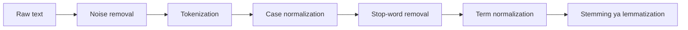

**In simple words:** raw text messy hota hai, isliye program use kare usse pehle hum use clean karte hain aur chhote uniform pieces mein kaat dete hain.

**Definition:** data preprocessing is cleaning a text before giving it to computers. <Cite id="class-nlp-m2" loc="p. 19" />

**Steps** <Cite id="class-nlp-asol" loc="p. 11" /> <Cite id="class-nlp-asol" loc="p. 12" /> <Cite id="class-nlp-m6" loc="slide 33" />

1. **Extraction aur noise removal:** HTML tags, markdown, metadata, tabs aur line breaks hataao; ek hi encoding (UTF-8) use karo.
2. **Tokenization:** text ke stream ko tokens (usually words) mein todo, whitespace aur punctuation se. Mushkil cases: state-of-the-art jaise hyphenated words aur bina spaces wali languages.
3. **Case normalization:** ek hi case, usually lowercase, taaki Information aur information ek term rahe.
4. **Stop-word removal:** the, is, a, and, in jaise bahut common words hataao.
5. **Term normalization:** commas, periods aur emojis hataao; U.S.A. aur USA ko ek form do.
6. **Stemming ya lemmatization:** stemming rules se endings kaat deta hai (retrieval, retrieved, retrieving ban jaate hain retriev); lemmatization dictionary word deta hai (better ban jaata hai good).

**Example** (stemming Porter stemmer se check ki gayi)

| Step | Output |
|---|---|
| Raw text | `
The Cats are Running in the Garden!
` |
| Noise removal | The Cats are Running in the Garden! |
| Tokenization | The, Cats, are, Running, in, the, Garden, ! |
| Lowercase aur bina punctuation | the, cats, are, running, in, the, garden |
| Stop-words hataye | cats, running, garden |
| Stemming | cat, run, garden |

**Conclusion:** preprocessing messy text ko clean tokens aur stems mein badalta hai jinhe model gin aur compare kar sake.
