**In simple words:** raw text is messy: capital letters, punctuation, tags, different word forms. Preprocessing cleans it and cuts it into a regular form so that later steps (tagging, parsing, classification) work better. <Cite id="text-preprocessing-gfg-pre" /> <Cite id="text-preprocessing-av-pre" />

**Why it is needed:** a computer treats *Cats*, *cats* and *cat* as different strings, and punctuation or HTML adds noise. Cleaning makes similar things look the same and shrinks the vocabulary.

```mermaid
%% caption: A usual preprocessing pipeline. Each step passes cleaner text to the next; the exact order and choice of steps depends on the task.
flowchart LR
  A["Raw text"] --> B["Noise removal"]
  B --> C["Sentence segmentation"]
  C --> D["Tokenization"]
  D --> E["Lowercasing"]
  E --> F["Stop-word removal"]
  F --> G["Stemming or lemmatization"]
  G --> H["Clean tokens"]
```

<Cite id="text-preprocessing-gfg-pre" loc="diagram" />

| Operation | What it does | Example |
|---|---|---|
| Noise removal | Remove HTML tags, URLs, symbols, extra spaces | `<b>Hi</b>!` becomes `Hi` |
| Sentence segmentation | Split text into sentences at ., ?, ! (care for "Dr.") | two sentences from one paragraph |
| Tokenization | Split a sentence into words or tokens <Cite id="text-preprocessing-slp3-ch2" /> | "don't" becomes `do`, `n't` |
| Lowercasing | Make all letters small | `The` becomes `the` |
| Stop-word removal | Drop very common words with little meaning <Cite id="text-preprocessing-gfg-stop" /> | remove *the, is, in* |
| Stemming | Chop suffixes by rules, may give non-words | `running` becomes `run` |
| Lemmatization | Return the dictionary base form using grammar | `better` becomes `good` <Cite id="text-preprocessing-ibm-stemlem" /> |

**Worked example.** Input: "The cats were running quickly in the garden!"

1. Lowercase and remove punctuation: `the cats were running quickly in the garden`.
2. Tokenize: [the, cats, were, running, quickly, in, the, garden].
3. Remove stop words (the, were, in, the): [cats, running, quickly, garden].
4. Stem (Porter): [cat, run, quickli, garden]. Lemmatize instead (knowing *running* is a verb): [cat, run, quickly, garden].

Note that the stemmer gave the non-word *quickli*, while lemmatization kept a real word.

**Precautions:** do not remove stop words for tasks where they matter (for example "not" in sentiment), and do not lowercase when case carries meaning (*Apple* the company).

**Conclusion:** preprocessing turns messy text into a clean, uniform token list; the steps are chosen to suit the task.
