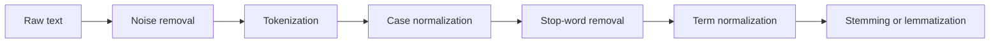

**In simple words:** raw text is messy, so before a program uses it we clean it and cut it into small uniform pieces.

**Definition:** data preprocessing is cleaning a text before giving it to computers. <Cite id="class-nlp-m2" loc="p. 19" />

**Steps** <Cite id="class-nlp-asol" loc="p. 11" /> <Cite id="class-nlp-asol" loc="p. 12" /> <Cite id="class-nlp-m6" loc="slide 33" />

1. **Extraction and noise removal:** remove HTML tags, markdown, metadata, tabs and line breaks; use one encoding (UTF-8).
2. **Tokenization:** break the stream of text into tokens, usually words, using whitespace and punctuation. Hard cases: hyphenated words like state-of-the-art and languages without spaces.
3. **Case normalization:** one case, usually lowercase, so Information and information are one term.
4. **Stop-word removal:** drop very common words such as the, is, a, and, in.
5. **Term normalization:** remove commas, periods and emojis; make U.S.A. and USA one form.
6. **Stemming or lemmatization:** stemming chops endings by rules (retrieval, retrieved, retrieving become retriev); lemmatization gives the dictionary word (better becomes good).

**Example** (stemming checked with the Porter stemmer)

| Step | Output |
|---|---|
| Raw text | `
The Cats are Running in the Garden!
` |
| Noise removal | The Cats are Running in the Garden! |
| Tokenization | The, Cats, are, Running, in, the, Garden, ! |
| Lowercase and no punctuation | the, cats, are, running, in, the, garden |
| Stop-words removed | cats, running, garden |
| Stemming | cat, run, garden |

**Conclusion:** preprocessing turns messy text into clean tokens and stems that a model can count and compare.
