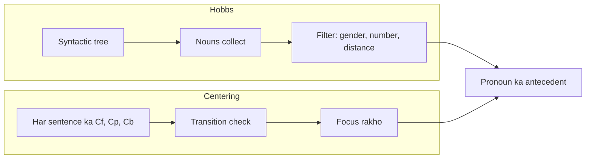

**In simple words:** Hobbs' algorithm aur Centering theory dono pronouns resolve karte hain, par Hobbs **sentence ke syntax tree mein search** karta hai, jabki Centering **sentence se sentence text kis baare mein hai ye follow** karta hai. <Cite id="class-nlp-asol" loc="p. 1" />

**Hobbs' algorithm** pronoun resolution ka heuristic method hai (Jerry Hobbs, 1976). Ye syntactic tree mein pronoun se start karta hai, upar jaata hai, same level aur uske upar wale level ke nouns collect karta hai aur gender, number agreement aur distance ke constraints lagata hai. Kuch suitable na mile to repeat karta hai. *Example:* "John saw Mary, he greeted her" mein nouns Mary aur John hain aur *he* = John. <Cite id="class-nlp-asol" loc="p. 3" /> <Cite id="class-nlp-asol" loc="p. 4" />

**Centering theory** har sentence ko forward-looking centers (**Cf**, ranked, subject pehle), preferred center (**Cp**) aur backward-looking center (**Cb**) deti hai. Transitions Continue (preferred), Retain aur Shift hain, aur wo wo antecedents prefer karti hai jo focus rakhein. *Example:* "Aragorn picked up the sword. He looked at Frodo." *He* = Aragorn. <Cite id="class-nlp-asol" loc="p. 2" /> <Cite id="class-nlp-asol" loc="p. 3" />

| Point | Hobbs' algorithm | Centering theory |
|---|---|---|
| Main idea | noun ke liye tree search | discourse focus tracking |
| Input needed | sentence ka syntactic tree | har sentence mein ranked entities |
| Scope | ek baar mein ek pronoun | poore discourse ka flow |
| Decides by | gender, number, distance | Continue, phir Retain, phir Shift |
| Kind | heuristic, syntax based | discourse based, coherence model |
| Also used for | sirf pronoun resolution | translation, summarization, story generation, conversational AI |

**Conclusion:** Hobbs tez hai aur sirf grammar use karta hai; Centering discourse context use karta hai, isliye coherent, lambe text ke liye theek hai.
