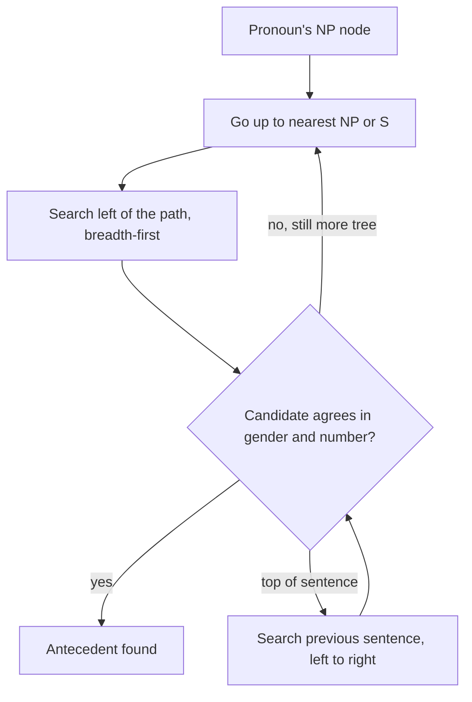

**In simple words:** Hobbs' algorithm aur Centering Theory dono computer ko decide karne mein help karte hain ki pronoun kisko refer kar raha hai. Hobbs antecedent dhundhne ke liye **syntax trees** mein search karta hai. Centering ye track karta hai ki **discourse kis baare mein hai** aur ye focus sentence se sentence kaise move karta hai. <Cite id="discourse-reference-slp3-coref" />

**Hobbs' algorithm (1978).** Ek "naive" rule-based method jise current aur pichle sentences ka parse tree chahiye. <Cite id="anaphora-resolution-hobbs1978" />

1. Pronoun ke NP node se shuru karo aur upar ke pehle NP ya S node tak jao.
2. Us node ke neeche ke tree mein, path ke left side, left to right aur breadth-first search karo. Wo NP candidate propose karo jiske aur node ke beech koi aur NP ya S ho.
3. Agar koi fit na ho, upar chadhte raho; sabse upar ke S pe pichle sentences search karo, sabse paas wale se, left to right.
4. Jo candidate gender ya number mein match na kare use reject karo.

**Centering Theory (Grosz, Joshi aur Weinstein, 1995).** Har sentence $U_n$ ke paas hota hai: <Cite id="discourse-reference-grosz1995" />

- **Cf**: forward-looking centers, jo entities mention hui, role ke hisaab se ranked (subject, phir object, phir baaki).
- **Cb**: backward-looking center, pichle sentence ki sabse high-ranked entity jo dobara mention hui; ye "topic" hai.
- **Cp**: Cf ka top-ranked item (preferred center).

Rule 1: agar koi bhi entity pronoun hai, to Cb pronoun hona chahiye. Rule 2: transitions ka order prefer karo: Continue, Retain, Smooth-shift, Rough-shift.

| Transition | Cb pehle jaisa? | Cb equals Cp? |
|---|---|---|
| Continue | yes | yes |
| Retain | yes | no |
| Smooth-shift | no | yes |
| Rough-shift | no | no |

Example: "John went to the store. He bought a book. **He** paid in cash." Pehle sentence ka Cb nahi hota, isliye hum teesre se judge karte hain. *He* John hai: Cb John hi rehta hai aur John subject (Cp) hai, to ye Continue hai. Brennan, Friedman aur Pollard (1987) ne ise pronoun resolution algorithm bana diya. <Cite id="anaphora-resolution-bfp1987" />

| Point | Hobbs' algorithm | Centering Theory |
|---|---|---|
| Based on | Syntactic parse trees | Discourse focus aur grammatical roles |
| Sawal | "Kaunsa NP antecedent hai?" | "Kaunsi entity focus mein hai; kya text coherent hai?" |
| Input | Har sentence ka full parse | Har sentence ki ranked entities |
| Scope | Pronoun by pronoun, current aur kuch pichle sentences | Poora discourse, sentence se sentence |
| Meaning use? | Kam (gender, number) | Kam (role ranking) |
| Output | Ek antecedent | Transition type aur preferred assignment |
| Weakness | Accurate parses chahiye, wider discourse ignore | Ranking rules chahiye, real texts underspecified hote hain |

**Similarity:** dono subject aur paas ke candidates ko prefer karte hain aur training data nahi maangte. <Cite id="anaphora-resolution-tp-nlp" />

**Conclusion:** Hobbs batata hai tree mein *kahan* dekhna hai; Centering batata hai text ka *focus kya hai*.

Exam mein English mein likho: "Hobbs' algorithm is syntax-based and searches parse trees; Centering Theory is discourse-based and tracks the focus of attention."
