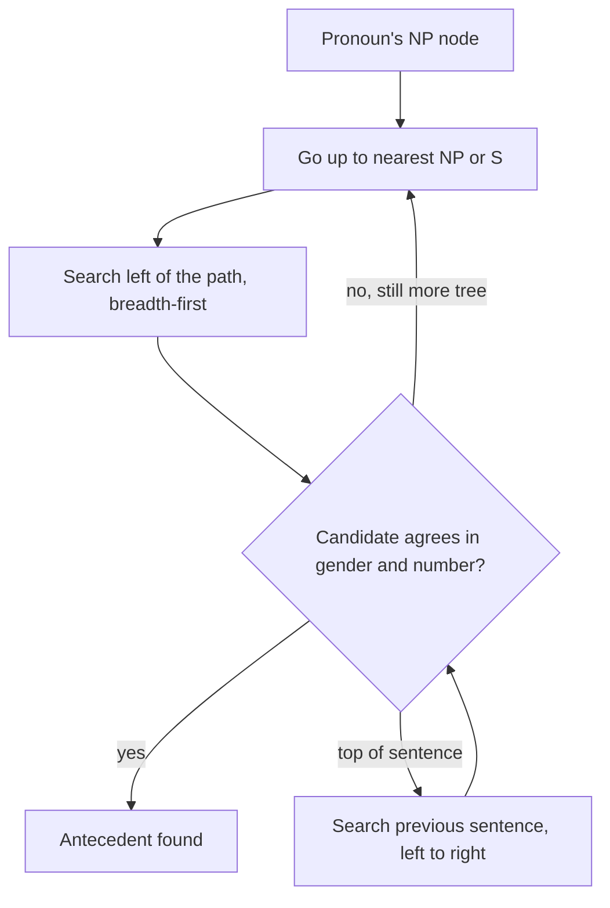

**In simple words:** both Hobbs' algorithm and Centering Theory help a computer decide what a pronoun refers to. Hobbs searches the **syntax trees** to find the antecedent. Centering tracks what the **discourse is about** and how that focus moves from sentence to sentence. <Cite id="discourse-reference-slp3-coref" />

**Hobbs' algorithm (1978).** A "naive" rule-based method that needs a parse tree of the current and earlier sentences. <Cite id="anaphora-resolution-hobbs1978" />

1. Start at the NP node of the pronoun and go up to the first NP or S node above it.
2. Search the tree below that node, left to right and breadth-first, to the left of the path. Propose a NP candidate that has another NP or S between it and the node.
3. If none fits, keep climbing; at the top S, search the earlier sentences, nearest first, left to right.
4. Reject any candidate that disagrees in gender or number.

**Centering Theory (Grosz, Joshi and Weinstein, 1995).** Each sentence $U_n$ has: <Cite id="discourse-reference-grosz1995" />

- **Cf**: forward-looking centers, the entities mentioned, ranked by role (subject, then object, then others).
- **Cb**: the backward-looking center, the highest-ranked entity of the previous sentence that is mentioned again; it is the "topic".
- **Cp**: the top-ranked item of Cf (preferred center).

Rule 1: if any entity is a pronoun, the Cb must be a pronoun. Rule 2: prefer transitions in the order Continue, Retain, Smooth-shift, Rough-shift.

| Transition | Cb same as before? | Cb equals Cp? |
|---|---|---|
| Continue | yes | yes |
| Retain | yes | no |
| Smooth-shift | no | yes |
| Rough-shift | no | no |

Example: "John went to the store. He bought a book. **He** paid in cash." The first sentence has no Cb, so we judge from the third. *He* is John: the Cb stays John and John is the subject (Cp), so it is a Continue. Brennan, Friedman and Pollard (1987) turned this into a pronoun resolution algorithm. <Cite id="anaphora-resolution-bfp1987" />

| Point | Hobbs' algorithm | Centering Theory |
|---|---|---|
| Based on | Syntactic parse trees | Discourse focus and grammatical roles |
| Question answered | "Which NP is the antecedent?" | "Which entity is in focus; is the text coherent?" |
| Input | Full parse of each sentence | Entities of each sentence, ranked |
| Scope | Pronoun by pronoun, current and a few earlier sentences | Whole discourse, sentence to sentence |
| Uses meaning? | Little (gender, number) | Little (role ranking) |
| Output | One antecedent | Transition type plus a preferred assignment |
| Weakness | Needs accurate parses, ignores wider discourse | Needs ranking rules, real texts are underspecified |

**Similarity:** both prefer the subject and nearby candidates and need no training data. <Cite id="anaphora-resolution-tp-nlp" />

**Conclusion:** Hobbs answers *where in the tree* to look; Centering answers *what the text is focused on*.
