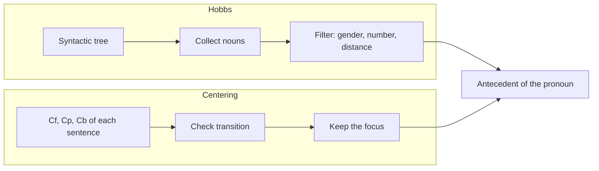

**In simple words:** both Hobbs' algorithm and Centering theory resolve pronouns, but Hobbs **searches the syntax tree of a sentence**, while Centering **follows what the text is about from sentence to sentence**. <Cite id="class-nlp-asol" loc="p. 1" />

**Hobbs' algorithm** is a heuristic method for pronoun resolution (Jerry Hobbs, 1976). It starts at the pronoun in the syntactic tree, moves up, collects the nouns on the same level and the level above, and applies constraints of gender, number agreement and distance. If nothing suitable is found, it repeats. *Example:* in "John saw Mary, he greeted her", the nouns are Mary and John and *he* = John. <Cite id="class-nlp-asol" loc="p. 3" /> <Cite id="class-nlp-asol" loc="p. 4" />

**Centering theory** gives each sentence forward-looking centers (**Cf**, ranked, subject first), a preferred center (**Cp**) and a backward-looking center (**Cb**). Transitions are Continue (preferred), Retain and Shift, and it prefers antecedents that keep the focus. *Example:* "Aragorn picked up the sword. He looked at Frodo." *He* = Aragorn. <Cite id="class-nlp-asol" loc="p. 2" /> <Cite id="class-nlp-asol" loc="p. 3" />

| Point | Hobbs' algorithm | Centering theory |
|---|---|---|
| Main idea | tree search for a noun | tracking discourse focus |
| Input needed | syntactic tree of the sentence | entities ranked in each sentence |
| Scope | one pronoun at a time | flow of the whole discourse |
| Decides by | gender, number, distance | Continue, then Retain, then Shift |
| Kind | heuristic, syntax based | discourse based, models coherence |
| Also used for | pronoun resolution only | translation, summarization, story generation, conversational AI |

**Conclusion:** Hobbs is quick and uses grammar only; Centering uses discourse context and so suits coherent, longer text.
