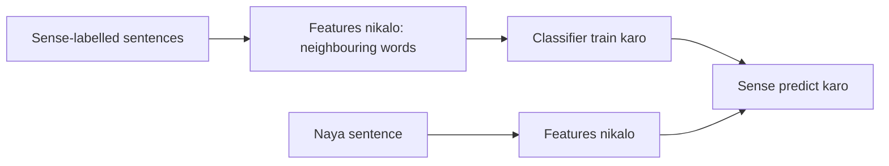

**In simple words:** supervised approach mein hum classifier ko bahut saare example sentences se sikhate hain jinme kisi insaan ne sahi sense mark kar diya hai. Phir wo naye sentences mein sense mark karta hai.

*(Class files supervised WSD ko detail mein cover nahi karti; wo bas batati hain ki labelled data mehnga hai, yaani "knowledge acquisition bottleneck" <Cite id="class-nlp-pyq4" loc="p. 8" />. Ye standard short answer hai.)*

**Idea:** WSD ko classification problem maante hain: word ka sense class hai, aur context features deta hai.

**Steps**

1. **Sense-tagged corpus jutao:** aise sentences jahan target word ko uske sense ke saath label kiya gaya ho (jaise *bank* = finance ya river).
2. **Features chuno:** aas-paas ke words (bag of words), word ke theek pehle aur baad ke words (collocations), aur part of speech.
3. In features par **classifier train karo.** Common classifiers Naive Bayes, decision lists aur support vector machines hain.
4. **Predict karo:** naye sentence ke liye wahi features nikalo aur classifier se sabse probable sense lo.
5. Known senses wale sentences par **evaluate karo.**

**Example:** "She deposited money in the bank": features *deposited* aur *money* classifier ko financial sense chunne par laate hain.

**Advantage:** aam taur par sabse accurate approach. **Disadvantage:** bada haath se labelled corpus chahiye, jo mehnga hai; Yarowsky bootstrapping method isi effort ko kam karne ke liye bana. <Cite id="class-nlp-pyq4" loc="p. 8" />

**Conclusion:** supervised WSD labelled examples se sense seekhta hai aur bada sense-tagged corpus maangta hai.
