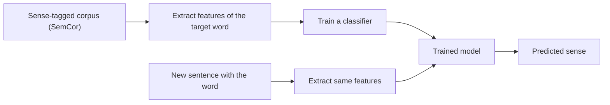

**In simple words:** supervised approach mein hum classifier ko bahut saare aise sentences dikhate hain jinme word ka sense insaano ne pehle se mark kiya hota hai. Wo seekhta hai ki kaunse context clues kaunse sense ke saath aate hain, phir naye sentences ko label karta hai. WSD ek aam classification problem ban jata hai: ek word, kai classes (senses). <Cite id="word-sense-disambiguation-slp3-I" /> <Cite id="word-sense-disambiguation-gfg-wsd" />

**Supervised kyun:** knowledge-based methods (Lesk) sirf dictionary overlap use karte hain aur kam accurate hote hain. Real usage pe train hua classifier patterns seekhta hai jaise "*deposit* ke paas *bank* ka matlab money hai".

**Steps**

1. **Data collect karo:** target word wale sentences aur unka sahi sense, jaise SemCor ya Senseval/SemEval sets se.
2. **Context window se features chuno:**
   - *collocational:* fixed positions pe exact words aur POS tags (ek word left, ek right);
   - *bag of words:* aas-paas kahin bhi kaunse words aaye (*money*, *river*), position ke bina.
3. **Train karo** classifier jaise Naive Bayes, decision list, SVM ya k-nearest neighbours, aam taur pe har target word ke liye alag.
4. **Predict karo:** naye sentence ke liye wahi features banao aur sabse high-scoring sense chuno.

**Naive Bayes rule:** wo sense $s$ chuno jo $P(s)\prod_j P(f_j \mid s)$ ko maximize kare, jahan $f_j$ context features hain. <Cite id="word-sense-disambiguation-wiki-naive-bayes" />

<Sum>

<Given>

(assumed numbers) *bank* ke senses: FIN jiska $P = 0.6$ aur RIVER jiska $P = 0.4$. $P(\text{deposit}\mid \text{FIN}) = 0.3$, $P(\text{money}\mid \text{FIN}) = 0.5$, $P(\text{deposit}\mid \text{RIVER}) = 0.01$, $P(\text{money}\mid \text{RIVER}) = 0.05$. Context: "deposit money in the bank".

</Given>

<Find>

*bank* ka sense.

</Find>

<Steps>

1. FIN score: $0.6 \times 0.3 \times 0.5 = 0.09$. *Reason: prior ko har feature probability se multiply karo.*
2. RIVER score: $0.4 \times 0.01 \times 0.05 = 0.0002$.
3. Bada score jeetta hai: $0.09 > 0.0002$.

</Steps>

<Answer>

*bank* = FIN (financial institution).

</Answer>

<Box kind="verify">

Normalise karo: $P(\text{FIN}\mid\text{context}) = 0.09 / (0.09 + 0.0002) = 0.09/0.0902 \approx 0.998$, aur RIVER ko $0.002$ milta hai; dono ka sum 1 hai. Ratio $0.09 / 0.0002 = 450$, to FIN bahut aage hai.

</Box>

</Sum>

| Advantages | Disadvantages |
|---|---|
| Data bada ho to WSD methods mein best accuracy | Sense-tagged data chahiye, jo banana costly hai |
| Real usage patterns seekhta hai | Har word ka alag model, rare senses ke liye weak |
| Evaluate karna aasan | Use hui sense list pe depend karta hai |

**Conclusion:** supervised WSD sense-tagged text pe context features se classifier train karta hai aur sabse probable sense chunta hai; iski main cost labelled data hai. <Cite id="word-sense-disambiguation-gale1992" />

Exam mein English mein likho: "In supervised WSD, a classifier is trained on a sense-annotated corpus using collocational and bag-of-words features."
