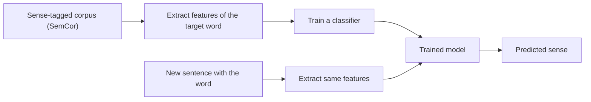

**In simple words:** in the supervised approach, we show a classifier many sentences in which the sense of a word is already marked by humans. It learns which context clues go with which sense, then uses them to label new sentences. WSD becomes an ordinary classification problem: one word, several classes (senses). <Cite id="word-sense-disambiguation-slp3-I" /> <Cite id="word-sense-disambiguation-gfg-wsd" />

**Why supervised:** knowledge-based methods (Lesk) use only dictionary overlap and are less accurate. A classifier trained on real usage learns patterns such as "*bank* near *deposit* means money".

**Steps**

1. **Collect data:** sentences with the target word and its correct sense, for example from SemCor or Senseval/SemEval sets.
2. **Pick features** from the context window:
   - *collocational:* the exact words and POS tags at fixed positions (one word left, one right);
   - *bag of words:* which words occur anywhere nearby (*money*, *river*), without position.
3. **Train** a classifier such as Naive Bayes, decision list, SVM or k-nearest neighbours, usually one per target word.
4. **Predict:** for a new sentence, build the same features and choose the highest-scoring sense.

**Naive Bayes rule:** choose the sense $s$ that maximizes $P(s)\prod_j P(f_j \mid s)$, where $f_j$ are the context features. <Cite id="word-sense-disambiguation-wiki-naive-bayes" />

<Sum>

<Given>

(assumed numbers) senses of *bank*: FIN with $P = 0.6$ and RIVER with $P = 0.4$. $P(\text{deposit}\mid \text{FIN}) = 0.3$, $P(\text{money}\mid \text{FIN}) = 0.5$, $P(\text{deposit}\mid \text{RIVER}) = 0.01$, $P(\text{money}\mid \text{RIVER}) = 0.05$. Context: "deposit money in the bank".

</Given>

<Find>

the sense of *bank*.

</Find>

<Steps>

1. FIN score: $0.6 \times 0.3 \times 0.5 = 0.09$. *Reason: prior times each feature probability.*
2. RIVER score: $0.4 \times 0.01 \times 0.05 = 0.0002$.
3. The larger score wins: $0.09 > 0.0002$.

</Steps>

<Answer>

*bank* = FIN (financial institution).

</Answer>

<Box kind="verify">

Normalise: $P(\text{FIN}\mid\text{context}) = 0.09 / (0.09 + 0.0002) = 0.09/0.0902 \approx 0.998$, and RIVER gets $0.002$; they add to 1. The ratio $0.09 / 0.0002 = 450$, so FIN is far ahead.

</Box>

</Sum>

| Advantages | Disadvantages |
|---|---|
| Best accuracy among WSD methods when data is large | Needs sense-tagged data, which is costly to make |
| Learns real usage patterns | A separate model for each word, poor for rare senses |
| Easy to evaluate | Depends on the sense list used |

**Conclusion:** supervised WSD trains a classifier on sense-tagged text using context features and picks the most probable sense; its main cost is the labelled data. <Cite id="word-sense-disambiguation-gale1992" />
