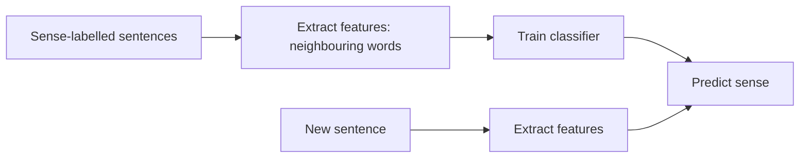

**In simple words:** in the supervised approach we teach a classifier with many example sentences in which a person has already marked the correct sense. It then marks the sense in new sentences.

*(The class files do not cover supervised WSD in detail; they mention that labelled data is expensive, the "knowledge acquisition bottleneck" <Cite id="class-nlp-pyq4" loc="p. 8" />. This is the standard short answer.)*

**Idea:** WSD is treated as a classification problem: the word's sense is the class, and the context gives the features.

**Steps**

1. **Collect a sense-tagged corpus:** sentences where the target word is labelled with its sense (for example *bank* = finance or river).
2. **Choose features:** nearby words (bag of words), the words just before and after (collocations), and the part of speech.
3. **Train a classifier** on these features. Common classifiers are Naive Bayes, decision lists and support vector machines.
4. **Predict:** for a new sentence, extract the same features and let the classifier give the most probable sense.
5. **Evaluate** on sentences with known senses.

**Example:** "She deposited money in the bank": the features *deposited* and *money* make the classifier choose the financial sense.

**Advantage:** usually the most accurate approach. **Disadvantage:** it needs a large hand-labelled corpus, which is costly; the Yarowsky bootstrapping method was made to reduce this effort. <Cite id="class-nlp-pyq4" loc="p. 8" />

**Conclusion:** supervised WSD learns the sense from labelled examples and needs a large sense-tagged corpus.
