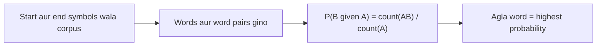

**In simple words:** language model pichhle words se agla word guess karta hai. N-gram model ye chhoti word sequences ginkar karta hai.

**Language model:** ek statistical ya machine learning model jo previous words diye hone par sequence ka agla word predict karta hai. Ye machine translation, speech recognition, text generation aur sentiment analysis mein use hota hai. <Cite id="class-nlp-pyq2" loc="p. 1" /> Ye word sequence ki probability $P(w_1, \dots, w_n)$ aur agle word ke liye $P(w_t \mid w_1, \dots, w_{t-1})$ estimate karta hai. <Cite id="class-nlp-m6" loc="slide 41" />

**N-gram:** text mein n words ki continuous sequence; N ki value order hai. <Cite id="class-nlp-m2" loc="p. 8" /> <Cite id="class-nlp-pyq2" loc="p. 1" />

- **Unigram:** ek single word (ek time par ek word dekhta hai).
- **Bigram:** consecutive words ka pair (pichhla ek word use karta hai).
- **Trigram:** teen consecutive words (pichhle do words use karta hai). <Cite id="class-nlp-m6" loc="slide 43" />

**Bigram probability:** $P(B \mid A) = \text{count}(AB)/\text{count}(A)$. Example: "The dog barks. The cat sleeps. The dog runs. The cat jumps." mein The 4 baar aaya aur The dog 2 baar, isliye $P(\text{dog} \mid \text{The}) = 2/4 = 0.5$. <Cite id="class-nlp-m2" loc="p. 9" />

**N-grams ke uses** <Cite id="class-nlp-pyq2" loc="p. 1" /> <Cite id="class-nlp-pyq2" loc="p. 8" />

- Context pakadna: ye dikhate hain ki words saath kaise kaam karte hain.
- Language models behtar banana: translation systems aur voice assistants guess karte hain ki aage kya aayega.
- Text prediction: predictive typing agla word suggest karti hai.
- Information retrieval: word patterns se documents rank karna.
- Spelling correction: "to school" "to stool" se zyada probable hai, isliye skul ban jaata hai school.

**Limits:** fixed context long-range links nahi pakad sakta, aur rare ya unseen sequences ko probability zero milti hai (data sparsity); add-one, add-k, Good-Turing aur Kneser-Ney jaisi smoothing isse theek karti hai. <Cite id="class-nlp-m6" loc="slide 43" /> <Cite id="class-nlp-m6" loc="slide 44" />

**Conclusion:** N-gram model corpus ke counts se pichhle n - 1 words dekhkar agla word predict karta hai.
