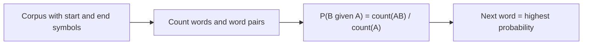

**In simple words:** a language model guesses the next word from the words before it. An N-gram model does this by counting short word sequences.

**Language model:** a statistical or machine learning model used to predict the next word in a sequence given the previous words. It is used in machine translation, speech recognition, text generation and sentiment analysis. <Cite id="class-nlp-pyq2" loc="p. 1" /> It estimates the probability of a word sequence $P(w_1, \dots, w_n)$ and, for the next word, $P(w_t \mid w_1, \dots, w_{t-1})$. <Cite id="class-nlp-m6" loc="slide 41" />

**N-gram:** a continuous sequence of n words in a text; the value of N is the order. <Cite id="class-nlp-m2" loc="p. 8" /> <Cite id="class-nlp-pyq2" loc="p. 1" />

- **Unigram:** a single word (considers one word at a time).
- **Bigram:** a pair of consecutive words (uses the previous one word).
- **Trigram:** three consecutive words (uses the previous two words). <Cite id="class-nlp-m6" loc="slide 43" />

**Bigram probability:** $P(B \mid A) = \text{count}(AB)/\text{count}(A)$. Example: in "The dog barks. The cat sleeps. The dog runs. The cat jumps." The appears 4 times and The dog 2 times, so $P(\text{dog} \mid \text{The}) = 2/4 = 0.5$. <Cite id="class-nlp-m2" loc="p. 9" />

**Uses of N-grams** <Cite id="class-nlp-pyq2" loc="p. 1" /> <Cite id="class-nlp-pyq2" loc="p. 8" />

- Capturing context: they show how words work together.
- Improving language models: translation systems and voice assistants guess what comes next.
- Text prediction: predictive typing suggests the next word.
- Information retrieval: ranking documents by word patterns.
- Spelling correction: "to school" is more probable than "to stool", so skul becomes school.

**Limits:** a fixed context cannot catch long-range links, and rare or unseen sequences get probability zero (data sparsity); smoothing such as add-one, add-k, Good-Turing and Kneser-Ney fixes this. <Cite id="class-nlp-m6" loc="slide 43" /> <Cite id="class-nlp-m6" loc="slide 44" />

**Conclusion:** an N-gram model predicts the next word from the previous n - 1 words using counts from a corpus.
