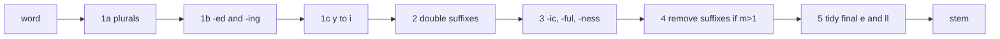

**In simple words:** stemming words ke endings kaat deta hai, taaki *connect, connected, connecting, connection* sab *connect* ban jaayein. Porter stemmer (Martin Porter, 1980) ye suffix rules ke paanch steps se karta hai, jo order mein lagte hain. <Cite id="porter-stemmer-def" /> <Cite id="porter-stemmer-gfg-stemming" />

**Kyun zaroori hai:** search aur text classification mein ek word ke alag forms ek hi count hone chahiye, aur isse vocabulary bhi chhoti hoti hai.

**Basic ideas** <Cite id="porter-stemmer-def" />

- Letters vowels hote hain (a, e, i, o, u, aur consonant ke baad y) ya consonants. Har word $[C](VC)^m[V]$ jaisa dikhta hai, aur **$m$ measure hai**: kitne vowel-consonant pairs hain. Examples: *tree* $m=0$, *trouble* $m=1$, *troubles* $m=2$.
- Rules aise dikhte hain: (condition) SUFFIX → NEW. Conditions: $m>0$; `*v*` (stem mein vowel hai); `*d` (double consonant pe end); `*o` (consonant-vowel-consonant pe end, last w, x, y nahi).
- Ek step mein sirf sabse lamba matching suffix try hota hai.

<Cite id="porter-stemmer-gfg-stemming" loc="diagram" />

| Step | Kya karta hai | Rules aur examples |
|---|---|---|
| 1a | plurals | SSES→SS (caresses→caress), IES→I (ponies→poni), S→ (cats→cat) |
| 1b | -ed, -ing (agar stem mein vowel ho) | plastered→plaster, motoring→motor; phir fix: hopping→hop (double letter hata), filing→file (m=1 aur cvc pe e joda) |
| 1c | y to i (agar stem mein vowel ho) | happy→happi |
| 2 | lambe suffixes agar $m>0$ | ATIONAL→ATE (relational→relate), IZATION→IZE, FULNESS→FUL |
| 3 | agar $m>0$ | ICATE→IC, ATIVE→(kuch nahi), ALIZE→AL, FUL→(kuch nahi), NESS→(kuch nahi) |
| 4 | suffixes delete (AL, ANCE, ER, IC, ABLE, ANT, MENT, ION, ATE, IVE, IZE aur baaki) agar $m>1$ | |
| 5 | final tidy | E hatao agar $m>1$ (ya $m=1$ aur `*o` nahi); controll→control |

<Sum>

<Given>

word *generalizations*.

</Given>

<Find>

iska Porter stem.

</Find>

<Steps>

1. **Step 1a:** S pe end hota hai (SS ya IES nahi), to hata do: *generalization*.
2. **Steps 1b, 1c:** koi -ed, -ing ya y ending nahi, to koi change nahi.
3. **Step 2:** suffix IZATION → IZE, stem *general* ka $m=3>0$: *generalize*.
4. **Step 3:** ALIZE → AL, stem *gener* ka $m=2>0$: *general*.
5. **Step 4:** suffix AL delete hota hai kyunki stem *gener* ka $m=2>1$: *gener*.
6. **Step 5:** R pe end hota hai, kuch nahi karna.

</Steps>

<Answer>

generalizations → **gener**

</Answer>

<Box kind="verify">

*gener* (g-e-n-e-r = C V C V C) ka $m$ dobara gino: pairs *en* aur *er* hain, to $m=2$, jo 1 se zyada hai, isliye step 4 allowed hai. Porter ke paper mein wahi word GENER tak trace hota hai, aur NLTK ka `PorterStemmer` bhi `gener` deta hai.

</Box>

</Sum>

**Advantages:** fast, simple, dictionary nahi chahiye, bahut use hota hai. **Disadvantages:** over-stem kar sakta hai (*university* aur *universe* dono *univers* ban jaate hain), under-stem, non-words (*happi*, *quickli*), aur sirf English ke liye. <Cite id="porter-stemmer-wiki-stem" />

**Conclusion:** Porter stemmer paanch ordered steps mein suffix hatata hai aur measure $m$ se chhote words ko zyada kaatne se bachata hai.

Exam mein English mein likho: "The Porter stemmer removes suffixes in five rule-based steps using the measure m of the stem."
