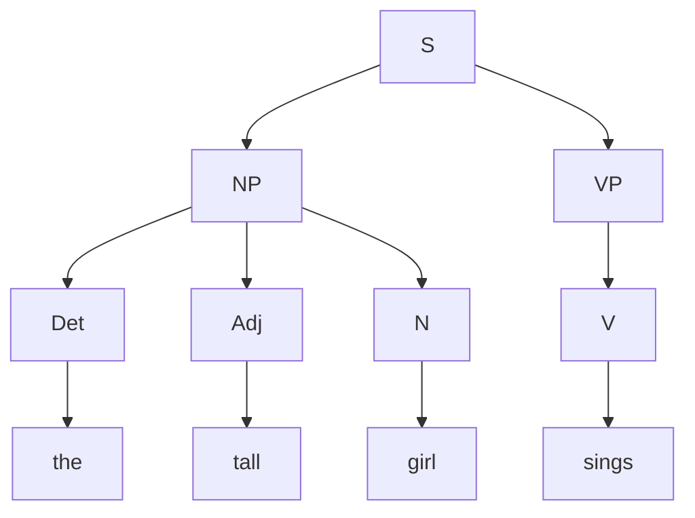

**In simple words:** context-free grammar (CFG) rewrite rules ki list hai. S se shuru karke hum ek symbol ko rule ke right side se badalte jaate hain jab tak sirf words na bachen. **Parse tree** dikhata hai ki kahan kaunsa rule use hua. Top-down parse start symbol se shuru hoti hai aur grammar ke rules se neeche aati hai. <Cite id="class-nlp-pyq3" loc="p. 6" />

<Sum>

<Given>

sentence *The tall girl sings* (capital T ko lexical entry "the" maana gaya hai). Rules: S → NP VP; NP → Det Adj N | Det N; VP → V | V NP; Det → "the"; Adj → "tall"; N → "girl"; V → "sings".

</Given>

<Find>

sentence ka parse tree.

</Find>

<Steps>

1. **Start:** S → NP VP. *Reason: S ka sirf yahi rule hai.*
2. **NP rule chuno.** Verb se pehle ke words *the tall girl* hain, teen words, to NP → Det Adj N use karo. Dusra rule NP → Det N sirf *the* aur *girl* cover karta aur *tall* bina match ke chhod deta, isliye fail hota hai.
3. **Lexical rules:** Det → the, Adj → tall, N → girl.
4. **VP rule chuno.** Sirf *sings* bacha hai, to VP → V. Rule VP → V NP fail hota hai kyunki NP ke liye koi word nahi bacha.
5. **Lexical rule:** V → sings.

Leftmost derivation:

$$
\begin{aligned}
S &\Rightarrow NP\ VP \Rightarrow Det\ Adj\ N\ VP \Rightarrow \text{the}\ Adj\ N\ VP \\
&\Rightarrow \text{the tall}\ N\ VP \Rightarrow \text{the tall girl}\ VP \\
&\Rightarrow \text{the tall girl}\ V \Rightarrow \text{the tall girl sings}
\end{aligned}
$$

</Steps>

<Answer>

Bracket form: `[S [NP [Det the] [Adj tall] [N girl]] [VP [V sings]]]`. Tree neeche hai.

</Answer>

<Box kind="verify">

Leaves ko left to right padho to *the tall girl sings* milta hai, jo original sentence hai. Har parent aur uske children grammar ke kisi rule se match karte hain. Derivation mein 7 rules lage (S, NP, VP aur 4 lexical rules), aur tree mein 7 internal nodes hain: S, NP, VP, Det, Adj, N, V.

</Box>

</Sum>

Grammar is sentence ka sirf ek parse deti hai, isliye ambiguity nahi hai. *The tall girl* noun phrase hai aur *sings* verb phrase.

**Conclusion:** S → NP VP, NP → Det Adj N aur VP → V lagakar, phir word rules, upar wala tree milta hai.
