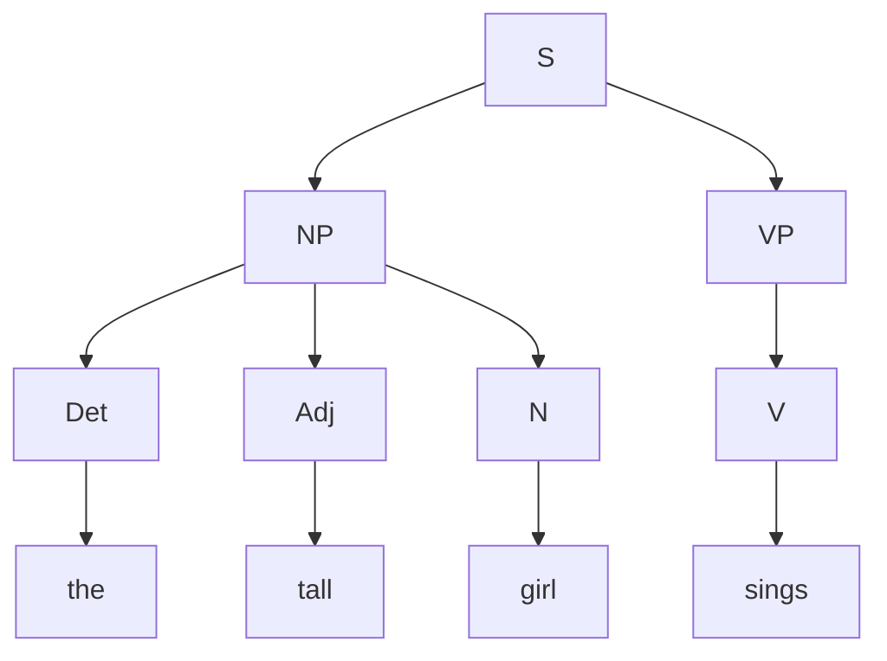

**In simple words:** a context-free grammar (CFG) is a list of rewrite rules. Starting from S, we replace a symbol by the right side of a rule until only words remain. The **parse tree** shows which rule was used where. A top-down parse starts from the start symbol and works down using the rules of the grammar. <Cite id="class-nlp-pyq3" loc="p. 6" />

<Sum>

<Given>

sentence *The tall girl sings* (the capital T is treated as the lexical entry "the"). Rules: S → NP VP; NP → Det Adj N | Det N; VP → V | V NP; Det → "the"; Adj → "tall"; N → "girl"; V → "sings".

</Given>

<Find>

the parse tree of the sentence.

</Find>

<Steps>

1. **Start:** S → NP VP. *Reason: S has only this rule.*
2. **Choose the NP rule.** The words before the verb are *the tall girl*, three words, so use NP → Det Adj N. The other rule NP → Det N would cover only *the* and *girl* and leave *tall* unmatched, so it fails.
3. **Lexical rules:** Det → the, Adj → tall, N → girl.
4. **Choose the VP rule.** Only *sings* is left, so VP → V. The rule VP → V NP fails because no words remain for the NP.
5. **Lexical rule:** V → sings.

Leftmost derivation:

$$
\begin{aligned}
S &\Rightarrow NP\ VP \Rightarrow Det\ Adj\ N\ VP \Rightarrow \text{the}\ Adj\ N\ VP \\
&\Rightarrow \text{the tall}\ N\ VP \Rightarrow \text{the tall girl}\ VP \\
&\Rightarrow \text{the tall girl}\ V \Rightarrow \text{the tall girl sings}
\end{aligned}
$$

</Steps>

<Answer>

Bracket form: `[S [NP [Det the] [Adj tall] [N girl]] [VP [V sings]]]`. The tree is below.

</Answer>

<Box kind="verify">

Reading the leaves left to right gives *the tall girl sings*, the original sentence. Every parent and its children match a rule of the grammar. The derivation used 7 rules (S, NP, VP and 4 lexical rules), and the tree has 7 internal nodes: S, NP, VP, Det, Adj, N, V.

</Box>

</Sum>

The grammar gives only one parse for this sentence, so there is no ambiguity. *The tall girl* is a noun phrase and *sings* is a verb phrase.

**Conclusion:** applying S → NP VP, NP → Det Adj N and VP → V, then the word rules, gives the tree above.
