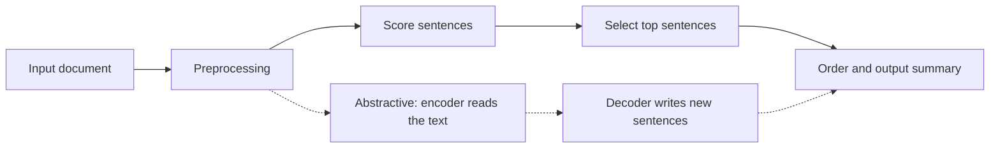

**In simple words:** text summarization lambe text ko chhote version mein badal deta hai jo main points rakhta hai. Ye waise hai jaise student chapter se revision notes banata hai. <Cite id="nlp-applications-gfg-summ" /> <Cite id="ambiguity-challenges-wiki-summ" />

**Kyun zaroori hai:** text (news, papers, reviews, emails) itna zyada hai ki koi sab nahi padh sakta, to summary time bachati hai aur search results aur alerts mein kaam aati hai.

**Types**

| Basis | Types |
|---|---|
| Method | **Extractive:** sabse important sentences jaise hain waise uthao. **Abstractive:** insaan ki tarah naye sentences likho. |
| Input | Single document ya multiple documents |
| Purpose | Generic, ya query-focused (diye hue question ka jawab) |
| Output | Indicative (text kis baare mein hai batata hai) ya informative (main facts rakhta hai) |

**Extractive summarization kaise kaam karta hai** <Cite id="pyq-2024-12-gfg-summ" />

1. **Preprocess:** sentences mein todo, tokenize karo, stop words hatao.
2. **Har sentence ko score karo** clues se: frequent important words (TF-IDF), position (pehle sentences), cue words ("in conclusion"), title words, ya sentence graph mein uski centrality jaise **TextRank** mein. <Cite id="nlp-applications-av-textrank" />
3. **Select** karo top-scoring sentences length limit ke andar.
4. **Order** karo unhe original jaise, taaki summary smooth padhi jaye.

<Cite id="nlp-applications-gfg-summ" loc="diagram" />

**Abstractive summarization** encoder-decoder (sequence-to-sequence) neural network use karta hai, aaj aam taur pe Transformer, jo text padhta hai aur naye words generate karta hai.

| Point | Extractive | Abstractive |
|---|---|---|
| Output sentences | Text se copy kiye | Naye likhe |
| Grammar aur facts | Safe, grammatical | Fluent par galat ho sakta hai (hallucination) |
| Difficulty | Aasan | Mushkil, bade models chahiye |
| Redundancy | Ideas repeat ho sakte hain | Ideas merge ho sakte hain |

**Evaluation:** ROUGE ginta hai ki human summary ke kitne words ya word groups system summary mein aaye. <Cite id="nlp-applications-rouge" />

**Applications:** news digests, search snippets, meeting notes, legal aur medical document briefs, review summaries.

**Conclusion:** summarization text ko key points tak compress karta hai, ya to sentences select karke (extractive) ya naye likhkar (abstractive).

Exam mein English mein likho: "Text summarization produces a short version of a document; it can be extractive or abstractive."
