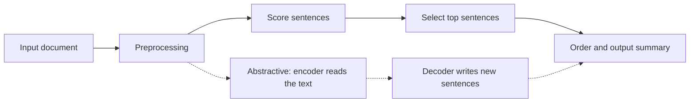

**In simple words:** text summarization shortens a long text into a short version that keeps the main points. It is like a student making revision notes from a chapter. <Cite id="nlp-applications-gfg-summ" /> <Cite id="ambiguity-challenges-wiki-summ" />

**Why it is needed:** there is far more text (news, papers, reviews, emails) than anyone can read, so a summary saves time and helps in search results and alerts.

**Types**

| Basis | Types |
|---|---|
| Method | **Extractive:** pick the most important sentences as they are. **Abstractive:** write new sentences, as a person would. |
| Input | Single document or multiple documents |
| Purpose | Generic, or query-focused (answers a given question) |
| Output | Indicative (tells what the text is about) or informative (holds the main facts) |

**How extractive summarization works** <Cite id="pyq-2024-12-gfg-summ" />

1. **Preprocess:** split into sentences, tokenize, remove stop words.
2. **Score each sentence** by clues: frequent important words (TF-IDF), position (first sentences), cue words ("in conclusion"), title words, or its centrality in a sentence graph as in **TextRank**. <Cite id="nlp-applications-av-textrank" />
3. **Select** the top-scoring sentences within the length limit.
4. **Order** them as in the original so the summary reads smoothly.

<Cite id="nlp-applications-gfg-summ" loc="diagram" />

**Abstractive summarization** uses an encoder-decoder (sequence-to-sequence) neural network, today usually a Transformer, which reads the text and generates new words.

| Point | Extractive | Abstractive |
|---|---|---|
| Output sentences | Copied from the text | Newly written |
| Grammar and facts | Safe, grammatical | May be fluent but wrong (hallucination) |
| Difficulty | Easier | Harder, needs large models |
| Redundancy | Can repeat ideas | Can merge ideas |

**Evaluation:** ROUGE counts how many words or word groups of a human summary appear in the system summary. <Cite id="nlp-applications-rouge" />

**Applications:** news digests, search snippets, meeting notes, legal and medical document briefs, review summaries.

**Conclusion:** summarization compresses text to its key points, either by selecting sentences (extractive) or by writing new ones (abstractive).
