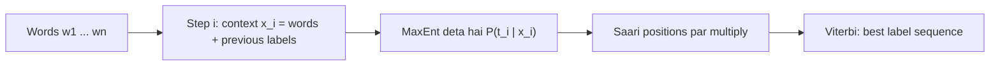

**In simple words:** sequence-labelling task mein har word ko ek label milta hai. Maximum Entropy ye rich clues (pichhle labels samet) se har label predict karke aur phir Viterbi se best poora sequence chun kar karta hai. <Cite id="class-nlp-pyq3" loc="p. 10" />

**Maximum Entropy short mein:** ek discriminative model (Multinomial Logistic Regression) jo $P(y \mid x)$, yaani context diya ho to label ki probability, weighted binary feature functions se model karta hai:

$$
P(y \mid x) = \frac{1}{Z(x)} \exp\Big(\sum_i \lambda_i f_i(x, y)\Big)
$$

jahan $Z(x)$ normalization factor hai aur $\lambda_i$ seekhe hue weights. Tagging ke feature examples: current word, previous tag, surrounding words, word ending, capitalization. <Cite id="class-nlp-pyq3" loc="p. 9" />

**Sequence tagging (MEMM):** poore sentence $W = (w_1, \ldots, w_n)$ ko tags $T = (t_1, \ldots, t_n)$ dene ke liye model ko step by step Maximum Entropy Markov Model ki tarah use karte hain:

$$
P(T \mid W) = \prod_{i=1}^{n} P(t_i \mid x_i)
$$

Context $x_i$ mein current aur aas-paas ke words aur pehle predict kiye tags $t_{i-1}, t_{i-2}$ hote hain. Best tag sequence Viterbi decoding se milta hai. <Cite id="class-nlp-pyq3" loc="p. 10" />

**Limitations** <Cite id="class-nlp-pyq3" loc="p. 10" />

1. **Label bias:** probabilities har step par locally ($Z(x_i)$) normalize hoti hain, poore sentence par nahi, isliye kam outgoing choices wale state se high-probability move haavi ho sakta hai, chahe poora sequence unlikely ho.
2. **Computational cost:** parameter estimation mein iterative optimization (L-BFGS, GIS, IIS) lagta hai, jo HMM ki counting se bhaari hai.

**Uses:** POS tagging, aur named entity recognition jaise doosre labelling tasks.

**Conclusion:** MaxEnt ko step by step MEMM ki tarah use karne se sequences rich features ke saath label hote hain, par local normalization label bias deta hai.
