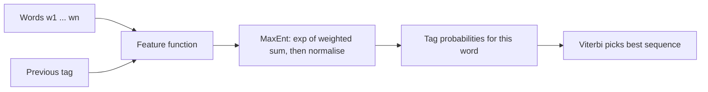

**In simple words:** Maximum Entropy (MaxEnt) model ek classifier hai jo har possible label ko kai clues (features) se score karta hai aur scores ko probabilities mein badalta hai. Sequence labeling (jaise POS tagging) ke liye hum ise har word pe baari-baari lagate hain, pichle tags ko extra clues banakar. Isse **MEMM** (Maximum Entropy Markov Model) kehte hain. <Cite id="hmm-maxent-crf-wiki-maxent" /> <Cite id="hmm-maxent-crf-slp3-ch18" />

**Principle:** jitne bhi models training data se agree karte hain unme se sabse high entropy wala chuno, yaani jo koi extra assumption na kare. Evidence na ho to saare labels barabar likely rehte hain. <Cite id="hmm-maxent-crf-berger1996" />

**Model.** History $h$ (words aur pichle tags) aur tag $t$ ke liye:

$$
P(t \mid h) = \frac{\exp\left(\sum_i \lambda_i f_i(h, t)\right)}{\sum_{t'} \exp\left(\sum_i \lambda_i f_i(h, t')\right)}
$$

Yahan har feature $f_i$ 1 hota hai agar uski condition sahi ho, warna 0, aur $\lambda_i$ uska seekha hua weight hai. Denominator probabilities ka sum 1 banata hai.

**POS tagging ke features** <Cite id="hmm-maxent-crf-ratnaparkhi1996" />

| Feature | Kab fire hota hai |
|---|---|
| word is *race* and tag is NN | current word race hai |
| previous tag is TO and tag is VB | "to" ke baad |
| word ends in *-ing* and tag is VBG | suffix clue |
| word is capitalised and tag is NNP | capital letter |

**Sequence labeling ke steps**

1. Sentence mein left se right chalo.
2. Word $i$ pe word, uske neighbours aur pichle tags se features nikalo.
3. Har tag ke liye $P(t_i \mid h_i)$ nikalo.
4. Poore tag sequence ki probability product $\prod_i P(t_i \mid t_{i-1}, w, i)$ hai; best sequence **Viterbi** ya beam search se dhundho.
5. **Training** wo $\lambda$ values chunti hai jo sahi tags ki likelihood maximize karein (iterative scaling ya gradient methods).

<Sum>

<Given>

(illustrative weights) word *race* tag TO ke baad. Active features: VB ko "previous tag is TO" ka weight 1.5 aur "word is race" ka weight 0.5 milta hai; NN ko "word is race" ka weight 1.0 milta hai.

</Given>

<Find>

$P(\text{VB} \mid h)$ aur $P(\text{NN} \mid h)$.

</Find>

<Steps>

1. Score VB $= 1.5 + 0.5 = 2.0$; score NN $= 1.0$. *Reason: jo features fire hue unke weights jodo.*
2. Exponentiate karo: $e^{2.0} = 7.389$ aur $e^{1.0} = 2.718$.
3. Normalise karo: $Z = 7.389 + 2.718 = 10.107$, to $P(\text{VB}) = 7.389/10.107 = 0.731$ aur $P(\text{NN}) = 2.718/10.107 = 0.269$.

</Steps>

<Answer>

$P(\text{VB}) \approx 0.731$, $P(\text{NN}) \approx 0.269$, to *race* ko VB tag milta hai.

</Answer>

<Box kind="verify">

$0.731 + 0.269 = 1.000$. Dusre tareeke se: $P(\text{VB}) = 1/(1+e^{-(2-1)}) = 1/(1+0.368) = 0.731$.

</Box>

</Sum>

| Point | HMM | MaxEnt (MEMM) |
|---|---|---|
| Type | Generative, $P(w, t)$ model karta hai | Discriminative, $P(t \mid w)$ model karta hai |
| Features | Sirf word aur pichla tag | Koi bhi overlapping features (suffix, capital, neighbours) |
| Unknown words | Weak | Suffix aur shape features se handle |

**Advantage:** rich features aur high accuracy (Ratnaparkhi ke tagger ne Penn Treebank pe lagbhag 96 percent paaya). **Disadvantages:** training slow hai, aur har state alag normalise hoti hai jisse **label bias** problem aati hai jo CRF theek karta hai. <Cite id="hmm-maxent-crf-wiki-memm" /> <Cite id="hmm-maxent-crf-collins-crf" />

**Conclusion:** MaxEnt har word ko weighted features ke normalised exponential se label karta hai, pichle tags ko clues banata hai, aur sequence Viterbi se decode karta hai.

Exam mein English mein likho: "In a MEMM, each tag is predicted by a maximum entropy classifier using word features and previous tags, and the best sequence is found by Viterbi."
