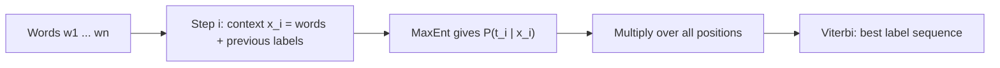

**In simple words:** a sequence-labelling task gives one label to every word. Maximum Entropy does it by predicting each label from rich clues, including the previous labels, and then choosing the best whole sequence with Viterbi. <Cite id="class-nlp-pyq3" loc="p. 10" />

**Maximum Entropy in short:** a discriminative model (Multinomial Logistic Regression) that models $P(y \mid x)$, the probability of a label given the context, using weighted binary feature functions:

$$
P(y \mid x) = \frac{1}{Z(x)} \exp\Big(\sum_i \lambda_i f_i(x, y)\Big)
$$

with $Z(x)$ the normalization factor and $\lambda_i$ the learned weights. Feature examples for tagging: current word, previous tag, surrounding words, word ending, capitalization. <Cite id="class-nlp-pyq3" loc="p. 9" />

**Sequence tagging (MEMM):** to tag a whole sentence $W = (w_1, \ldots, w_n)$ with tags $T = (t_1, \ldots, t_n)$, the model is used step by step as a Maximum Entropy Markov Model:

$$
P(T \mid W) = \prod_{i=1}^{n} P(t_i \mid x_i)
$$

The context $x_i$ has the current and surrounding words and the previously predicted tags $t_{i-1}, t_{i-2}$. The best tag sequence is found with Viterbi decoding. <Cite id="class-nlp-pyq3" loc="p. 10" />

**Limitations** <Cite id="class-nlp-pyq3" loc="p. 10" />

1. **Label bias:** probabilities are normalized locally at each step ($Z(x_i)$) instead of over the whole sentence, so a high-probability move from a state with few outgoing choices can dominate even when the whole sequence is unlikely.
2. **Computational cost:** parameter estimation needs iterative optimization (L-BFGS, GIS, IIS), heavier than the counting of an HMM.

**Uses:** POS tagging, and other labelling tasks such as named entity recognition.

**Conclusion:** MaxEnt used step by step as an MEMM labels sequences with rich features, but local normalization causes label bias.
