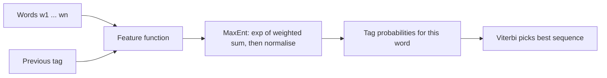

**In simple words:** a Maximum Entropy (MaxEnt) model is a classifier that scores each possible label using many clues (features) and turns the scores into probabilities. For sequence labeling (such as POS tagging) we apply it to each word in turn, with the earlier tags as extra clues. This is the **MEMM** (Maximum Entropy Markov Model). <Cite id="hmm-maxent-crf-wiki-maxent" /> <Cite id="hmm-maxent-crf-slp3-ch18" />

**The principle:** among all models that agree with the training data, choose the one with the highest entropy, that is, the one that makes no extra assumptions. Without any evidence, all labels stay equally likely. <Cite id="hmm-maxent-crf-berger1996" />

**The model.** For a history $h$ (the words and the previous tags) and a tag $t$:

$$
P(t \mid h) = \frac{\exp\left(\sum_i \lambda_i f_i(h, t)\right)}{\sum_{t'} \exp\left(\sum_i \lambda_i f_i(h, t')\right)}
$$

Here each feature $f_i$ is 1 if its condition holds and 0 otherwise, and $\lambda_i$ is its learned weight. The denominator makes the probabilities add to 1.

**Features for POS tagging** <Cite id="hmm-maxent-crf-ratnaparkhi1996" />

| Feature | Fires when |
|---|---|
| word is *race* and tag is NN | the current word is race |
| previous tag is TO and tag is VB | after "to" |
| word ends in *-ing* and tag is VBG | suffix clue |
| word is capitalised and tag is NNP | capital letter |

**Steps for sequence labeling**

1. Move through the sentence left to right.
2. At word $i$, compute the features from the word, its neighbours and the previous tags.
3. Compute $P(t_i \mid h_i)$ for each tag.
4. The probability of the whole tag sequence is the product $\prod_i P(t_i \mid t_{i-1}, w, i)$; find the best sequence with **Viterbi** or beam search.
5. **Training** chooses the $\lambda$ values that maximize the likelihood of the correct tags (iterative scaling or gradient methods).

<Sum>

<Given>

(illustrative weights) word *race* after the tag TO. Active features: VB gets "previous tag is TO" with weight 1.5 and "word is race" with weight 0.5; NN gets "word is race" with weight 1.0.

</Given>

<Find>

$P(\text{VB} \mid h)$ and $P(\text{NN} \mid h)$.

</Find>

<Steps>

1. Score VB $= 1.5 + 0.5 = 2.0$; score NN $= 1.0$. *Reason: add the weights of the features that fire.*
2. Exponentiate: $e^{2.0} = 7.389$ and $e^{1.0} = 2.718$.
3. Normalise: $Z = 7.389 + 2.718 = 10.107$, so $P(\text{VB}) = 7.389/10.107 = 0.731$ and $P(\text{NN}) = 2.718/10.107 = 0.269$.

</Steps>

<Answer>

$P(\text{VB}) \approx 0.731$, $P(\text{NN}) \approx 0.269$, so *race* is tagged VB.

</Answer>

<Box kind="verify">

$0.731 + 0.269 = 1.000$. Another way: $P(\text{VB}) = 1/(1+e^{-(2-1)}) = 1/(1+0.368) = 0.731$.

</Box>

</Sum>

| Point | HMM | MaxEnt (MEMM) |
|---|---|---|
| Type | Generative, models $P(w, t)$ | Discriminative, models $P(t \mid w)$ |
| Features | Only word and previous tag | Any overlapping features (suffix, capital, neighbours) |
| Unknown words | Weak | Handled through suffix and shape features |

**Advantage:** rich features and high accuracy (Ratnaparkhi's tagger reached about 96 percent on Penn Treebank). **Disadvantages:** training is slower, and each state is normalised alone, which causes the **label bias** problem that CRFs fix. <Cite id="hmm-maxent-crf-wiki-memm" /> <Cite id="hmm-maxent-crf-collins-crf" />

**Conclusion:** MaxEnt labels each word by a normalised exponential of weighted features, uses previous tags as clues, and decodes the sequence with Viterbi.
