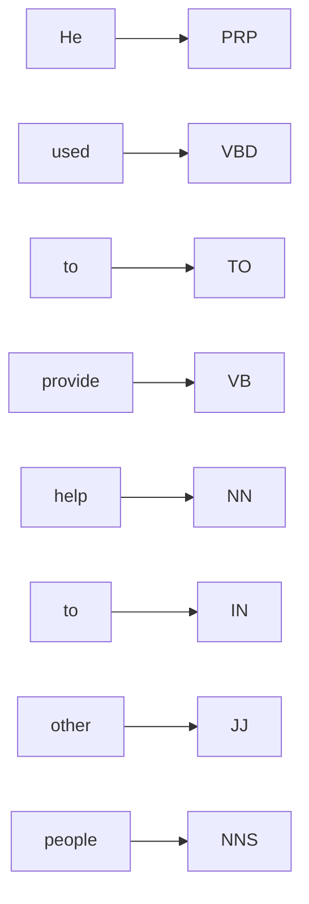

**In simple words:** words are sorted into classes by the job they do. Some classes keep getting new words (open), others are a small fixed list (closed). Tagging then gives each word its class label. <Cite id="class-nlp-pyq3" loc="p. 1" />

**Open class words:** words that readily accept new vocabulary additions and changes. They are typically content words that convey meaning, such as nouns, verbs, adjectives and adverbs. These classes are open to expansion and innovation as languages evolve. <Cite id="class-nlp-pyq3" loc="p. 1" />

- Nouns: book, dog, computer
- Verbs: run, eat, sleep
- Adjectives: big, red, happy
- Adverbs: quickly, softly, beautifully

**Closed class words:** words that do not readily accept new members. They are often function words that serve grammatical purposes and show structural relationships within sentences. These classes are relatively stable and resistant to change over time. <Cite id="class-nlp-pyq3" loc="p. 1" />

- Pronouns: he, she, it, they
- Prepositions: on, in, at, with
- Conjunctions: and, but, or, so
- Determiners: the, a, an, some (the articles *the, a, an* are determiners)

| Point | Open class | Closed class |
|---|---|---|
| New words | Easily added | Hardly ever added |
| Kind of word | Content words (meaning) | Function words (grammar) |
| Examples | book, run, big, quickly | he, on, and, the |

**Tagging "He used to provide help to other people."** Each word gets the tag that matches its job here. <Cite id="class-nlp-pyq3" loc="p. 1" />

| Word | POS tag | Word class |
|---|---|---|
| He | PRP | Pronoun |
| used | VBD | Verb (past tense) |
| to | TO | Infinitive marker |
| provide | VB | Verb |
| help | NN | Noun |
| to | IN | Preposition |
| other | JJ | Adjective |
| people | NNS | Plural noun |

*Why these tags:* *used* is a past-tense verb; the first *to* sits in front of the verb *provide*, so it is the infinitive marker; *help* is the thing provided, so it is a noun; the second *to* is followed by a noun phrase, so it is a preposition (the class answer uses IN for it); *other* describes *people*; *people* is plural. (The Penn Treebank gives the tag TO to every *to*; write the table as in class.)

**Conclusion:** open classes carry the meaning, closed classes carry the grammar, and POS tags label every word with its class.
