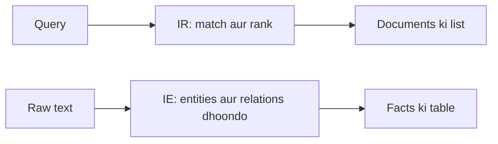

**In simple words:** Information Retrieval (IR) tumhari query se match karte **documents** dhoondhta hai, jaise search engine. Information Extraction (IE) text padh kar **facts** (kaun, kya, kahan, kab) nikalta hai aur table mein bharta hai. IR tumhe padhne ke liye pages deta hai; IE tayyar answers deta hai. <Cite id="pyq-2025-05-gfg-ir-ie" />

**Information Retrieval.** User query likhta hai. System usse documents ke index se match karta hai, rank karta hai aur best documents dikhata hai. Example: Google pe "best phone under 20000" search karo to ranked web pages ki list milti hai. Methods: tokenization, stemming, TF-IDF, ranking. <Cite id="pyq-2025-05-wiki-ir" />

**Information Extraction.** System unstructured text padhta hai aur ek fixed template bharta hai. Example: "Tata Motors hired Ravi on 5 May 2024 as manager" se nikalta hai: Company = Tata Motors, Person = Ravi, Date = 5 May 2024, Role = manager. Methods: named entity recognition, relation extraction, rules ya machine learning. <Cite id="pyq-2025-05-wiki-ie" />

| Point | Information Retrieval | Information Extraction |
|---|---|---|
| Goal | Relevant documents dhoondhna | Text ke andar ke specific facts dhoondhna |
| Input | Query plus document collection | Text documents |
| Output | Documents ki ranked list | Structured data (table, template) |
| Methods | Indexing, TF-IDF, ranking | NER, relation extraction, templates |
| Language ki depth | Shallow (keywords) | Deeper (grammar, meaning) |
| Measure | Precision, recall | Har fact ka precision, recall |
| Example | Web search | News padh kar company database bharna |

**Dono ka link:** IE aksar IR ke baad chalta hai, un documents par jo IR ne diye.

**Conclusion:** IR batata hai "kaun se documents?", IE batata hai "unme kaun se facts hain?".
