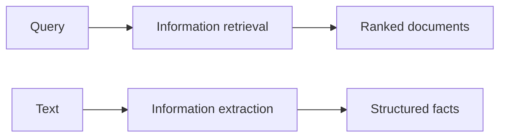

**In simple words:** IR query ke liye **documents** deta hai; IE text se **facts** nikaalta hai. *(Class files IR aur NER define karti hain par information extraction ko topic ki tarah nahi; neeche ki comparison chhoti aur standard hai.)*<Cite id="class-nlp-m6" loc="slide 9" /><Cite id="class-nlp-m6" loc="slide 35" />

| Point | Information retrieval | Information extraction |
|---|---|---|
| Output | ranked documents | structured facts |
| Question | kaun se documents relevant hain? | text mein kaun se facts hain? |
| Input | query aur collection | ek text |
| Steps | acquisition, representation, file organization, matching | tokenizing, POS tagging, entity detection |
| Example | search engine | news se names aur dates |

IR us librarian jaisa hai jo batata hai kaun si book padhni hai; IE book padhkar key facts ko table mein likhne jaisa hai. <Cite id="class-nlp-m6" loc="slide 9" />

**Conclusion:** IR documents dhoondhta hai; IE facts nikaalta hai, aur named entity recognition ek IE step hai.
