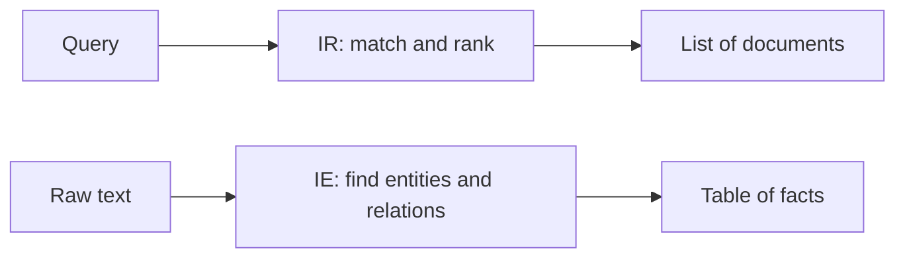

**In simple words:** Information Retrieval (IR) finds the **documents** that match your query, like a search engine. Information Extraction (IE) reads text and pulls out **facts** (who, what, where, when) into a table. IR gives you pages to read; IE gives you the answers already filled in. <Cite id="pyq-2025-05-gfg-ir-ie" />

**Information Retrieval.** The user types a query. The system matches it with an index of documents, ranks them and shows the best ones. Example: Google search for "best phone under 20000" returns a ranked list of web pages. Typical methods: tokenization, stemming, TF-IDF, ranking. <Cite id="pyq-2025-05-wiki-ir" />

**Information Extraction.** The system reads unstructured text and fills a fixed template. Example: from "Tata Motors hired Ravi on 5 May 2024 as manager" it extracts Company = Tata Motors, Person = Ravi, Date = 5 May 2024, Role = manager. Typical methods: named entity recognition, relation extraction, rules or machine learning. <Cite id="pyq-2025-05-wiki-ie" />

| Point | Information Retrieval | Information Extraction |
|---|---|---|
| Goal | Find relevant documents | Find specific facts inside text |
| Input | A query plus a document collection | Text documents |
| Output | Ranked list of documents | Structured data (table, template) |
| Methods | Indexing, TF-IDF, ranking | NER, relation extraction, templates |
| Depth of language use | Shallow (keywords) | Deeper (grammar, meaning) |
| Measured by | Precision, recall | Precision, recall of each fact |
| Example | Web search | Reading news to fill a company database |

**Link between them:** IE is often run after IR, on the documents that IR returned.

**Conclusion:** IR answers "which documents?", IE answers "what facts do they contain?".
