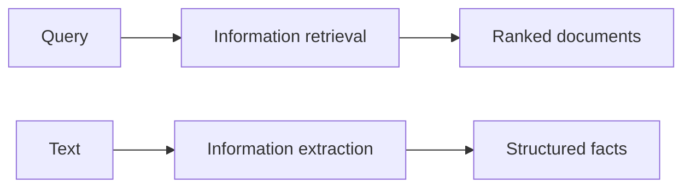

**In simple words:** IR gives you **documents** for a query; IE pulls **facts** out of a text. *(The class files define IR and NER but not information extraction as a topic; the comparison below is short and standard.)*<Cite id="class-nlp-m6" loc="slide 9" /><Cite id="class-nlp-m6" loc="slide 35" />

| Point | Information retrieval | Information extraction |
|---|---|---|
| Output | ranked documents | structured facts |
| Question | which documents are relevant? | what facts does the text state? |
| Input | a query and a collection | a text |
| Steps | acquisition, representation, file organization, matching | tokenizing, POS tagging, entity detection |
| Example | a search engine | names and dates from news |

IR is like a librarian who tells you which book to read; IE is like reading the book and writing the key facts in a table. <Cite id="class-nlp-m6" loc="slide 9" />

**Conclusion:** IR finds the documents; IE extracts the facts, and named entity recognition is one IE step.
