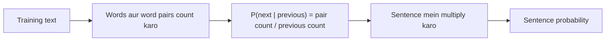

**In simple words:** language model sentence ko probability deta hai, taaki wo bata sake ki "I love NLP", "NLP love I" se zyada likely hai. N-gram model sabse simple hai: wo agla word sirf pichhle kuch words se guess karta hai. <Cite id="ngram-language-models-slp3-ch3" /> <Cite id="ngram-language-models-wiki-ngram" />

**Language model.** Language model word sequence ki probability $P(w_1, w_2, \dots, w_n)$ deta hai, ya pichhle words ke baad agle word ki probability. Uses: speech recognition, spelling correction, machine translation, autocomplete. <Cite id="ngram-language-models-av-lm" />

**N-gram model.** N-gram N words ka sequence hai. Model maanta hai ki agla word sirf pichhle $N-1$ words par depend karta hai (Markov assumption). $P(w_i \mid w_{i-1})$ ka matlab hai word $w_i$ ki probability jab uske theek pehle $w_{i-1}$ aaya ho:

$$
P(w_1 \dots w_n) \approx \prod_{i=1}^{n} P(w_i \mid w_{i-1}), \qquad
P(w_i \mid w_{i-1}) = \frac{C(w_{i-1} w_i)}{C(w_{i-1})}
$$

$C(\cdot)$ training text mein count hai. <Cite id="ngram-language-models-gfg-ngram" />

| Model | Kya dekhta hai | "love" ke liye example |
|---|---|---|
| Unigram | koi history nahi | $P(\text{love})$ |
| Bigram | 1 pichhla word | $P(\text{love}\mid\text{I})$ |
| Trigram | 2 pichhle words | $P(\text{NLP}\mid\text{I love})$ |

<Sum>

<Given>

Training corpus ($\langle s\rangle$ = sentence ki shuruaat, $\langle /s\rangle$ = end): (1) $\langle s\rangle$ I love NLP $\langle /s\rangle$, (2) $\langle s\rangle$ I love music $\langle /s\rangle$, (3) $\langle s\rangle$ I study NLP $\langle /s\rangle$.

</Given>

<Find>

"$\langle s\rangle$ I love NLP $\langle /s\rangle$" ki bigram probability.

</Find>

<Steps>

1. $P(\text{I}\mid\langle s\rangle) = C(\langle s\rangle\,\text{I}) / C(\langle s\rangle) = 3/3 = 1$.
2. $P(\text{love}\mid\text{I}) = 2/3$, kyunki "I" 3 baar aaya aur "I love" 2 baar.
3. $P(\text{NLP}\mid\text{love}) = 1/2$, kyunki "love" 2 baar aaya aur "love NLP" 1 baar.
4. $P(\langle /s\rangle\mid\text{NLP}) = 2/2 = 1$.
5. Multiply karo: $1 \times \tfrac23 \times \tfrac12 \times 1 = \tfrac13$. *Reason: sentence ki probability uski bigram probabilities ka product hoti hai.*

</Steps>

<Answer>

$P = 1/3 \approx 0.333$

</Answer>

<Box kind="verify">

Teeno corpus sentences ko $1/3$ milta hai ("I love music": $1\times\frac23\times\frac12\times1$; "I study NLP": $1\times\frac13\times1\times1$), aur $\frac13+\frac13+\frac13 = 1$, jaisa hona chahiye. Ye sentence 3 training sentences mein se 1 mein hai, to $1/3$ expected value bhi hai.

</Box>

</Sum>

<Cite id="ngram-language-models-gfg-ngram" loc="diagram" />

**Advantages:** simple, fast, sirf counts chahiye. **Disadvantages:** history chhoti dekhta hai, to door ke links chhoot jaate hain; unseen word pairs ko probability zero milti hai, jise **smoothing** (jaise add-one) theek karti hai; bade N ke liye bahut data chahiye. <Cite id="ngram-language-models-slp3-ch3" />

**Conclusion:** N-gram model N-word groups ki counts se sentence probability nikalta hai, aur smoothing unseen groups sambhalti hai.
