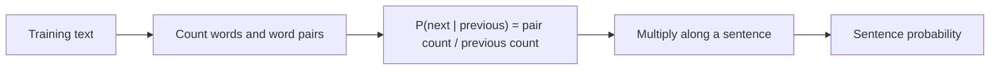

**In simple words:** a language model gives a probability to a sentence, so it can tell that "I love NLP" is more likely than "NLP love I". The N-gram model is the simplest one: it guesses the next word from the previous few words only. <Cite id="ngram-language-models-slp3-ch3" /> <Cite id="ngram-language-models-wiki-ngram" />

**Language model.** A language model assigns a probability $P(w_1, w_2, \dots, w_n)$ to a word sequence, or the probability of the next word given the earlier words. Uses: speech recognition, spelling correction, machine translation, autocomplete. <Cite id="ngram-language-models-av-lm" />

**N-gram model.** An N-gram is a sequence of N words. The model says that the next word depends only on the previous $N-1$ words (Markov assumption). Writing $P(w_i \mid w_{i-1})$ for the probability of word $w_i$ given the word just before it:

$$
P(w_1 \dots w_n) \approx \prod_{i=1}^{n} P(w_i \mid w_{i-1}), \qquad
P(w_i \mid w_{i-1}) = \frac{C(w_{i-1} w_i)}{C(w_{i-1})}
$$

$C(\cdot)$ is a count in the training text. <Cite id="ngram-language-models-gfg-ngram" />

| Model | Looks at | Example for "love" |
|---|---|---|
| Unigram | no history | $P(\text{love})$ |
| Bigram | 1 previous word | $P(\text{love}\mid\text{I})$ |
| Trigram | 2 previous words | $P(\text{NLP}\mid\text{I love})$ |

<Sum>

<Given>

Training corpus (with $\langle s\rangle$ = start and $\langle /s\rangle$ = end of a sentence): (1) $\langle s\rangle$ I love NLP $\langle /s\rangle$, (2) $\langle s\rangle$ I love music $\langle /s\rangle$, (3) $\langle s\rangle$ I study NLP $\langle /s\rangle$.

</Given>

<Find>

the bigram probability of "$\langle s\rangle$ I love NLP $\langle /s\rangle$".

</Find>

<Steps>

1. $P(\text{I}\mid\langle s\rangle) = C(\langle s\rangle\,\text{I}) / C(\langle s\rangle) = 3/3 = 1$.
2. $P(\text{love}\mid\text{I}) = 2/3$, since "I" occurs 3 times and "I love" twice.
3. $P(\text{NLP}\mid\text{love}) = 1/2$, since "love" occurs twice and "love NLP" once.
4. $P(\langle /s\rangle\mid\text{NLP}) = 2/2 = 1$.
5. Multiply: $1 \times \tfrac23 \times \tfrac12 \times 1 = \tfrac13$. *Reason: the sentence probability is the product of its bigram probabilities.*

</Steps>

<Answer>

$P = 1/3 \approx 0.333$

</Answer>

<Box kind="verify">

The three corpus sentences each get $1/3$ (for "I love music": $1\times\frac23\times\frac12\times1$; for "I study NLP": $1\times\frac13\times1\times1$), and $\frac13+\frac13+\frac13 = 1$, as it must. The sentence appears in 1 of the 3 training sentences, so $1/3$ is also the expected value.

</Box>

</Sum>

<Cite id="ngram-language-models-gfg-ngram" loc="diagram" />

**Advantages:** simple, fast, needs only counts. **Disadvantages:** sees only a short history, so long-distance links are lost; unseen word pairs get probability zero, which is fixed by **smoothing** (for example add-one); large N needs huge data. <Cite id="ngram-language-models-slp3-ch3" />

**Conclusion:** an N-gram model estimates sentence probability from counts of N-word groups, and smoothing handles unseen groups.
